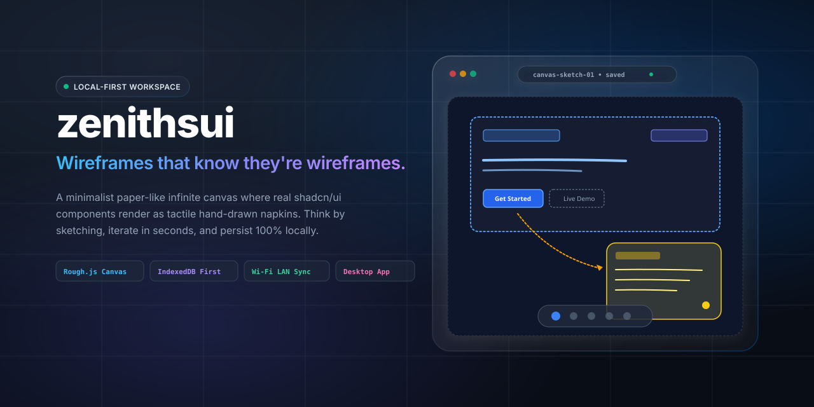
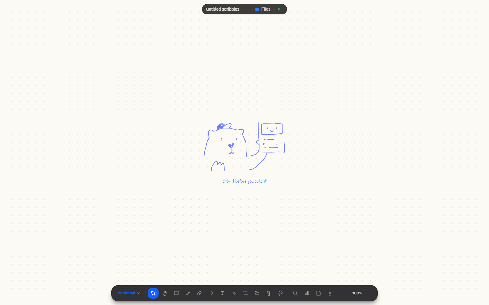
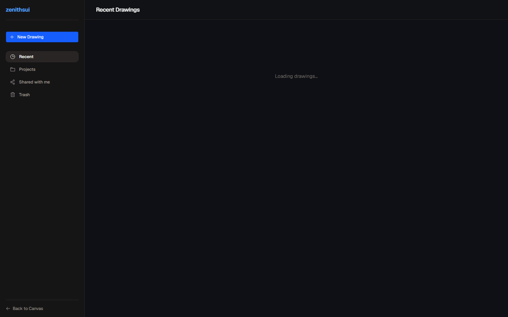
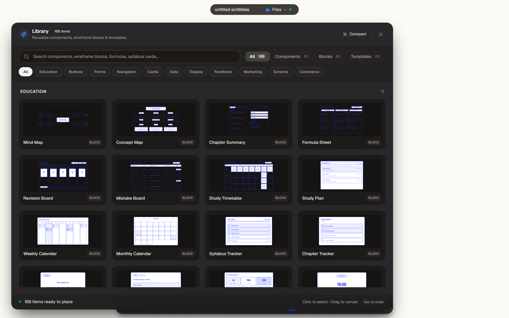
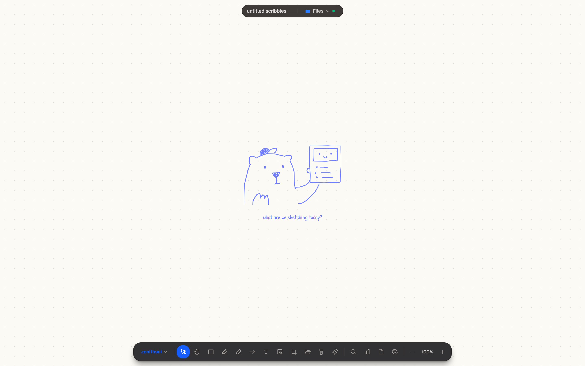
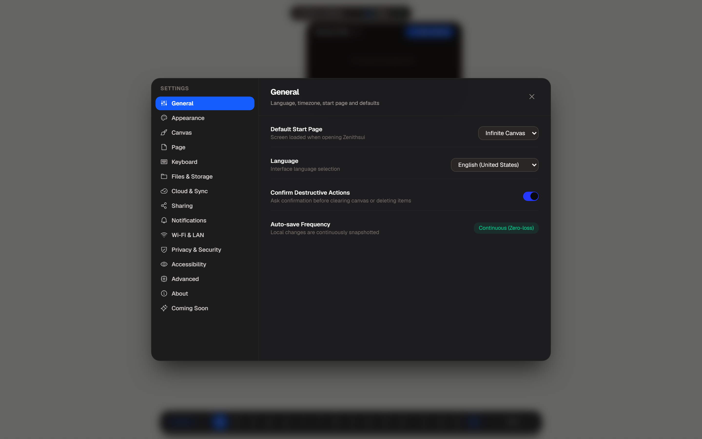
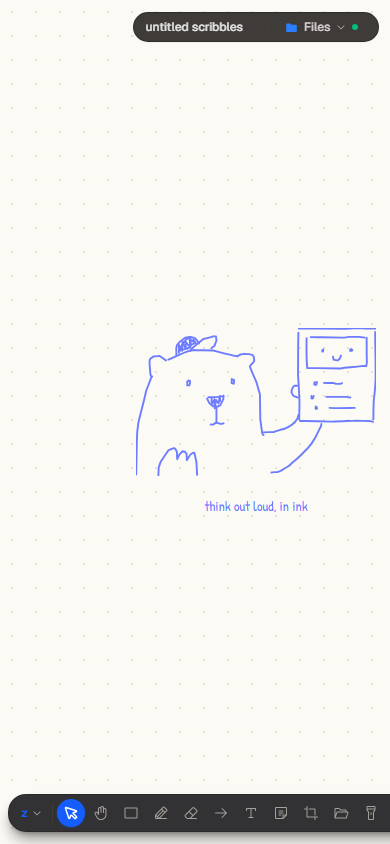
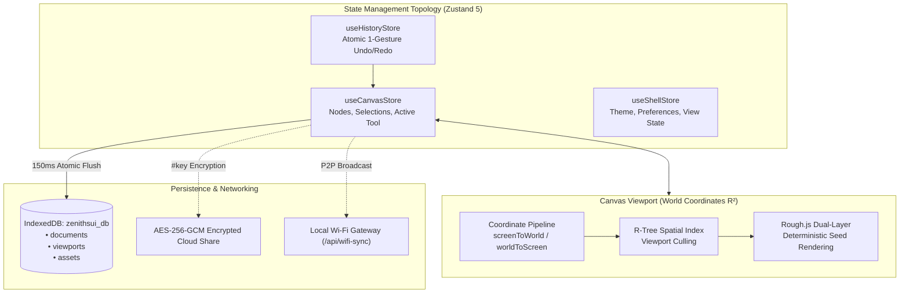

<div align="center">

<a href="https://zenithsui.vercel.app/" target="_blank" rel="noopener noreferrer">
  
</a>

# zenithsui

### **Wireframes that know they're wireframes.**

An infinite, local-first digital canvas where real UI components render as tactile hand-drawn sketches.<br />
Designed for product thinkers, systems engineers, and students who think by drawing.

<br />

[](https://github.com/amitdev7/notepadbackup/actions/workflows/ci.yml)
[](https://nextjs.org/)
[](https://react.dev/)
[](https://www.typescriptlang.org/)
[](https://tailwindcss.com/)
[](https://pnpm.io/)
[](https://www.electronjs.org/)
[-059669?style=flat-square)](docs/STORAGE.md)
[-10B981?style=flat-square)](docs/TESTING.md)

<br />

<p align="center">
  <a href="https://zenithsui.netlify.app/" target="_blank" rel="noopener noreferrer">
    
  </a>&nbsp;&nbsp;
  <a href="https://zenithsui.vercel.app/" target="_blank" rel="noopener noreferrer">
    
  </a>&nbsp;&nbsp;
  <a href="https://github.com/amitdev7/notepadbackup/releases">
    
  </a>&nbsp;&nbsp;
  <a href="docs/README.md">
    
  </a>&nbsp;&nbsp;
  <a href="https://app.netlify.com/start/deploy?repository=https://github.com/amitdev7/notepadbackup">
    
  </a>
</p>

<br />

### ⚡ Core Engineering Vitals

| Perceived Latency | Viewport Motion | Privacy Model | Stroke Determinism | Verification Status | Storage Engine |
| :---: | :---: | :---: | :---: | :---: | :---: |
| **`0 ms`**<br/><sub>In-Memory Zustand</sub> | **`60 FPS`**<br/><sub>Sub-Pixel Vector Math</sub> | **`AES-256-GCM`**<br/><sub>Zero-Knowledge Hash</sub> | **`32-Bit Seeds`**<br/><sub>Deterministic Strokes</sub> | **`38 / 38 Passed`**<br/><sub>100% Suite Coverage</sub> | **`IndexedDB v2`**<br/><sub>100% Offline Autonomy</sub> |

</div>

---

## Table of Contents

- [Why Zenithsui?](#why-zenithsui)
- [Product Showcase](#product-showcase)
- [Key Capabilities](#key-capabilities)
  - [Procedural Canvas Engine](#1-procedural-canvas-engine)
  - [Interactive Component Vocabulary](#2-interactive-component-vocabulary)
  - [Local-First Persistence](#3-local-first-persistence)
  - [Cryptographic Sharing and LAN Collaboration](#4-cryptographic-sharing-and-lan-collaboration)
  - [Academic OS Workspace](#5-academic-os-workspace)
  - [Native Desktop Shell](#6-native-desktop-shell)
- [Architecture and Data Flow](#architecture-and-data-flow)
- [Theme System and Physical Materials](#theme-system-and-physical-materials)
- [Technology Stack](#technology-stack)
- [Getting Started](#getting-started)
  - [Prerequisites](#prerequisites)
  - [Installation and Local Run](#installation-and-local-run)
  - [Building for Production](#building-for-production)
  - [Desktop Packaging](#desktop-packaging)
- [Environment Configuration](#environment-configuration)
- [Automated Testing and Quality Assurance](#automated-testing-and-quality-assurance)
- [Keyboard Shortcuts](#keyboard-shortcuts)
- [Project Directory Map](#project-directory-map)
- [Documentation Index](#documentation-index)
- [Roadmap](#roadmap)
- [Contributing](#contributing)
- [Security Policy](#security-policy)
- [License Notice](#license-notice)

---

## Why Zenithsui?

Modern digital design tools force creators into an artificial dilemma:

- **Figma** accelerates premature optimization. Opening high-fidelity tools pulls you into auto-layout padding, border-radius debates, and microscopic pixel nudging before the information architecture is even validated.
- **Generic Whiteboard Apps** provide freedom, but treat software UI as dumb boxes. You are forced to draw buttons, dropdowns, inputs, and modal dialogs from scratch, stroke by stroke, with no component intelligence.

**Zenithsui bridges the gap**: an infinite digital canvas where you drag in structured, interactive UI components, yet everything renders with deterministic, hand-drawn paper-like sketch ink.

```
┌─────────────────────────┐          ┌───────────────────────────────────┐          ┌─────────────────────────┐
│     Generic Whiteboard  │          │             ZENITHSUI             │          │       Figma / Sketch    │
├─────────────────────────┤          ├───────────────────────────────────┤          ├─────────────────────────┤
│ • Blank geometric boxes │          │ • Real shadcn/ui components       │          │ • Pixel-perfect vectors │
│ • No component state    │   ───►   │ • Hand-drawn napkin aesthetic     │   ───►   │ • Heavy styling burden  │
│ • Manual line drawing   │          │ • 1-click live variant switching  │          │ • Premature fidelity    │
│ • Cloud sign-in wall    │          │ • 100% offline local-first memory │          │ • Proprietary lock-in   │
└─────────────────────────┘          └───────────────────────────────────┘          └─────────────────────────┘
```

> [!TIP]
> **The Napkin Invariant**: The sketchy look is the point. When wireframes look intentionally unfinished, reviewers, clients, and teammates critique **product flow, messaging, and structural hierarchy** instead of debating whether button corner radius should be 6px or 8px.

<p align="right"><a href="#zenithsui">back to top ↑</a></p>

---

## Product Showcase

<div align="center">

### Main Infinite Canvas Workspace

<p><em>Infinite canvas rendering procedural Rough.js sketch geometry with Apple Liquid Glass chrome overlays.</em></p>

<br />

| Multi-Document Workspace | Component Library Drawer |
|:---:|:---:|
|  |  |
| **Local-First File Manager**: Instant document switching backed by atomic IndexedDB autosave. | **Component Vocabulary**: Drag-and-drop shadcn/ui primitives with pre-built blocks. |

| Property Inspector & Variants | System Settings & Theme Configurator |
|:---:|:---:|
|  |  |
| **Contextual Inspector**: Switch component variants, sizes, and icon positions live. | **Theming & Display**: Multi-theme switching (Light, Dark, Sepia, Midnight) & time calibration. |

| Command Palette (⌘K) | Multi-Device Responsive Viewports |
|:---:|:---:|
|  |  |
| **Spotlight Command Palette**: Instant keyboard search for tools, actions, and blocks. | **Adaptive Viewports**: Full touch navigation, gesture panning, and responsive docks. |

</div>

<p align="right"><a href="#zenithsui">back to top ↑</a></p>

---

## Key Capabilities

### 1. Procedural Canvas Engine
- **Deterministic Seed Invariant**: Every sketch shape carries a stable 32-bit integer `seed`. Rough.js procedural strokes, corner overshoots, and hachures remain mathematically identical across pans, zooms, theme toggles, and reloads without re-jittering.
- **Sub-Pixel Coordinate Pipeline**: Infinite Cartesian plane with zoom scale factor $z \in [0.10, 5.00]$. Transforms between screen pixels and world coordinates at 60 FPS.
- **R-Tree Spatial Index**: Bounding-box spatial queries cull off-screen nodes, supporting 10,000+ elements with sub-millisecond hit-testing.
- **Laser Pointer Physics**: Interactive presentation pointer with sub-pixel trajectory tracking and exponential opacity trail decay.
- **Temporary Canvas Elements**: Ephemeral scratch notes and wireframe annotations with configurable expiration countdowns and an archive recovery drawer.

### 2. Interactive Component Vocabulary
- **shadcn/ui Wireframe Vocabulary**: Buttons, text inputs, selects, switches, sliders, tables, dialogs, tabs, accordions, and navigation bars.
- **Pre-Engineered Blocks**: Instant templates for hero rows, pricing grids, FAQ cards, chat interfaces, and checkout flows.
- **Live Variant Flipping**: Toggle button sizes, filled vs. outline styling, and icon placements in the inspector without destroying node identity.
- **One-Way Detach**: Break any component into editable geometric primitives (rectangles, text, lines) whenever custom edge-case fidelity is required.

### 3. Local-First Persistence
- **Zero-Network Autonomy**: 100% of core creation and document editing functions without internet access. Local IndexedDB (`zenithsui_db` v2) is the primary source of truth.
- **150ms Atomic Autosave**: In-memory Zustand mutations update the screen with 0ms perceived latency and flush to disk via debounced atomic IndexedDB transactions.
- **Viewport Memory System**: Remembers exact camera coordinates $(x, y)$ and zoom levels per document, restoring your viewpoint upon document switching.
- **Bi-directional Excalidraw Parity**: Import and export standard `.excalidraw` documents and `.excalidrawlib` component libraries with full geometric fidelity.

### 4. Cryptographic Sharing and LAN Collaboration
- **Client-Side AES-256-GCM Sharing**: Documents are encrypted in the browser using 256-bit AES-GCM before upload. Decryption keys are appended strictly to the URL hash fragment (`#key=...`), ensuring the host server never accesses plaintext canvas data (RFC 3986).
- **Peer-to-Peer Wi-Fi LAN Bridge**: Real-time canvas synchronization over local Wi-Fi networks without external internet access or third-party cloud intermediaries.
- **SSRF-Protected Media Proxy**: High-security server-side asset proxy (`/api/assets/proxy`) validating IP subnets and blocking private RFC-1918 networks, loopback addresses, and cloud metadata endpoints.

### 5. Academic OS Workspace
- **Curriculum & Syllabus Trees**: Structured hierarchical study tracking with visual completion heatmaps.
- **Academic Planner & 4-Mode Calendar**: Month, Week, Day, and Agenda schedule planners with automatic conflict detection.
- **Spaced Repetition & Recall**: Integrated Leitner box revision engine calculating retention decay intervals.
- **Academic Guardian**: Distraction-free focus timers with session time bounds and analytics.

### 6. Native Desktop Shell
- **Self-Contained Windows Binaries**: High-performance NSIS installer (`.exe`) and standalone portable distribution powered by Electron 45.
- **Hardened Sandboxing**: Strict context isolation (`contextIsolation: true`) and disabled Node integration in renderers with typed preload bridges.
- **Seamless Auto-Updates**: Native background update checking via `electron-updater` targeting official GitHub releases.

<p align="right"><a href="#zenithsui">back to top ↑</a></p>

---

## Architecture and Data Flow

Zenithsui enforces a strict architectural boundary separating the **Infinite Canvas Viewport** from the **VisionOS Chrome**:



### Coordinate Transformation Equations

#### Screen to World (`screenToWorld`)
Calculates the canvas world coordinate $(w_x, w_y)$ from a pointer event on screen $(s_x, s_y)$:
$$w_x = \frac{s_x - v_x}{z}, \quad w_y = \frac{s_y - v_y}{z}$$

#### World to Screen (`worldToScreen`)
Transforms stored document coordinates $(w_x, w_y)$ into screen render pixels $(s_x, s_y)$:
$$s_x = w_x \cdot z + v_x, \quad s_y = w_y \cdot z + v_y$$

*For deeper architectural specifications, read [docs/ARCHITECTURE.md](docs/ARCHITECTURE.md).*

<p align="right"><a href="#zenithsui">back to top ↑</a></p>

---

## Theme System and Physical Materials

Zenithsui binds all surfaces, strokes, and typography dynamically to Tailwind CSS v4 semantic design tokens:

| Theme | Canvas Background | Ink Primary | Visual Role |
|---|---|---|---|
| **Light** | `#FAF9F5` (Paper White) | `#2563EB` (Napkin Blue) | Classic drafting paper for daytime ideation |
| **Dark** | `#18181B` (Charcoal) | `#E4E4E7` (White Ink) | Low-glare studio slate for extended design sessions |
| **Sepia** | `#FBF0D9` (Warm Parchment) | `#78350F` (Tuscan Ink) | Warm, tactile notebook paper with reduced blue light |
| **Midnight** | `#090D16` (Deep Space) | `#38BDF8` (Cyan Ink) | Pure OLED black with high-contrast electric accents |
| **System** | Adaptive | Adaptive | Dynamically synchronizes with the host operating system |

### Physical Smart Hover Cards
Sticky annotations and hover notes support 5 physical material styles:
1. **Yellow Slate**: Cyber yellow bezel with matte obsidian slate.
2. **Ice Ceramic**: Translucent ice-sky glass rim with frosted ceramic white core.
3. **Royal Slate**: Apple royal blue casing with deep slate backdrop.
4. **Cyan Slate**: Cyan boundary with muted charcoal inner card.
5. **Acrylic Glass**: Warm amber rim with translucent glass refraction.

<p align="right"><a href="#zenithsui">back to top ↑</a></p>

---

## Technology Stack

Every package and version is verified directly from [`package.json`](package.json):

| Category | Technology | Version | Description |
|---|---|---|---|
| **Core Framework** | [Next.js](https://nextjs.org/) | `16.2.12` | App Router, Serverless API handlers, Turbopack engine |
| **UI Library** | [React](https://react.dev/) | `19.2.4` | Concurrent transitions, modern hooks architecture |
| **Language** | [TypeScript](https://www.typescriptlang.org/) | `5.0` | Strict type safety across all canvas math and store APIs |
| **Styling & Design** | [Tailwind CSS](https://tailwindcss.com/) | `4.x` | Next-gen CSS-first compiler (`@theme inline`), VisionOS glass |
| **Canvas Rendering** | [Rough.js](https://roughjs.com/) | `4.6.6` | Deterministic procedural sketch geometry and fills |
| **State Management** | [Zustand](https://zustand.docs.pmnd.rs/) | `5.0.14` | High-frequency reactive micro-stores, gesture locking |
| **Local Storage** | Browser IndexedDB | Native | Zero-latency local-first storage engine (`zenithsui_db`) |
| **Desktop Shell** | [Electron](https://www.electronjs.org/) | `45.2.1` | Native Windows executable packaging and auto-updater |
| **Iconography** | [Phosphor Icons](https://phosphoricons.com/) | `2.1.10` | Consistent Apple-style vector iconography |
| **Cloud (Optional)** | [Supabase](https://supabase.com/) | `2.49.1` | Cloud backup and collaborative invite resolution |
| **Package Manager** | [pnpm](https://pnpm.io/) | `10.4.1` | Fast, deterministic content-addressable package management |

<p align="right"><a href="#zenithsui">back to top ↑</a></p>

---

## Getting Started

### Prerequisites
- **Node.js**: `20.x`, `22.x` (recommended), or `24.x`
- **pnpm**: `>= 10.4.0` (pinned to `10.4.1` via `packageManager`)
- **Git**: `>= 2.30`

### Installation and Local Run

1. **Clone the repository**:
   ```bash
   git clone https://github.com/amitdev7/notepadbackup.git
   cd notepadbackup
   ```

2. **Install dependencies**:
   ```bash
   pnpm install --frozen-lockfile
   ```

3. **Initialize local environment**:
   ```bash
   cp .env.example .env.local
   ```
   *(Zenithsui operates 100% offline out-of-the-box. Cloud variables are optional).*

4. **Start development server**:
   ```bash
   pnpm dev
   ```
   Open [http://localhost:3000](http://localhost:3000) in your browser.

### Building for Production

Compile an optimized production build using Next.js with Turbopack:
```bash
pnpm build
pnpm start
```

### Desktop Packaging

Build standalone Windows desktop installers from source:
```bash
# Compile Next.js standalone assets and Electron main process
pnpm desktop:build

# Generate Windows NSIS Installer (.exe)
pnpm desktop:dist:nsis

# Generate Standalone Portable Executable (.exe)
pnpm desktop:dist:portable

# Output files will be generated in: dist-desktop/
```

<p align="right"><a href="#zenithsui">back to top ↑</a></p>

---

## Environment Configuration

Zenithsui requires **zero environment variables** for offline local use. External variables are only needed for optional cloud sync, authentication, or remote media storage:

| Variable | Scope | Status | Purpose |
|---|---|---|---|
| `NEXT_PUBLIC_SUPABASE_URL` | Public | Optional | Supabase cloud project API endpoint |
| `NEXT_PUBLIC_SUPABASE_ANON_KEY` | Public | Optional | Supabase client authentication key |
| `SUPABASE_SERVICE_ROLE_KEY` | Secret | Optional | Server-only key for backend document operations |
| `SHARE_SESSION_SECRET` | Secret | Recommended | 32+ char secret for signing HMAC-SHA256 share tokens |
| `BLOB_READ_WRITE_TOKEN` | Secret | Optional | Vercel Blob access token for large file uploads |
| `NEXT_PUBLIC_SITE_URL` | Public | Optional | Canonical production URL (auto-detected on Vercel) |
| `ZENITHSUI_GATEWAY_SECRET` | Secret | Recommended | Secret key authorizing local Wi-Fi peer synchronization |

*Read [docs/CONFIGURATION.md](docs/CONFIGURATION.md) for complete configuration instructions.*

<p align="right"><a href="#zenithsui">back to top ↑</a></p>

---

## Automated Testing and Quality Assurance

Zenithsui includes **38 dedicated automated test suites** verifying mathematical invariants, collision geometry, security rules, and offline sync mechanics:

```bash
# Run all 38 test suites sequentially
pnpm test

# Run TypeScript static type check
pnpm exec tsc --noEmit

# Run ESLint 9 validation
pnpm lint
```

<details>
<summary><strong>Click to view the 38 Test Suites Breakdown</strong></summary>

<br />

| Subsystem | Test Suites | Verification Coverage |
|---|---|---|
| **Canvas & Geometry** | `test-geometry.ts`<br/>`test-selection.ts`<br/>`test-clipboard.ts`<br/>`test-text.ts`<br/>`test-image-border-text-zoom.ts`<br/>`test-viewport-memory.ts`<br/>`test-temporary-elements.ts`<br/>`test-canvas-parity.ts`<br/>`test-canvas-full-features.ts`<br/>`test-regression.ts` | Bounding-box intersections, marquee selection, serialized MIME clipboard, font measurement, persistent viewport memory, laser trail decay, Excalidraw parity. |
| **Security & Networking** | `test-security.ts`<br/>`test-asset-proxy-security.ts`<br/>`test-phase2-permissions.ts`<br/>`test-phase2-sharing.ts`<br/>`test-phase2-invitations.ts`<br/>`test-phase2-public.ts`<br/>`test-wifi-auto-sync-consent.ts`<br/>`test-lan.ts` | 110 XSS input checks, 16 SSRF vector checks (RFC-1918/metadata blocklist), AES-256-GCM token encryption, Wi-Fi gateway peer isolation. |
| **Storage & Database** | `test-database.ts`<br/>`test-sync.ts`<br/>`test-document-switching-race.ts`<br/>`test-production-hardening.ts` | PostgreSQL schemas, Supabase RLS policies, atomic autosave commits, async document switching race prevention. |
| **Files & Media** | `test-document-attachments.ts`<br/>`test-pdf-service.ts` | Binary attachments, SHA-256 integrity, PDF rendering and page extraction. |
| **Theming, Keyboard & Time** | `test-hover-notes.ts`<br/>`test-clock-location.ts`<br/>`test-zen-mode-keybind.ts` | 14 card theme styles, spring-lerp GPU motion, NTP time calibration, timezone resolution, customizable pure canvas Zen Mode keybind. |
| **Academic OS** | `test-academic-analytics.ts`<br/>`test-academic-syllabus.ts`<br/>`test-academic-planner.ts`<br/>`test-academic-guardian.ts`<br/>`test-academic-db.ts`<br/>`test-phase3-revision.ts`<br/>`test-phase3-practice.ts`<br/>`test-phase3-recommender.ts`<br/>`test-student-hub.ts`<br/>`test-functional-calendar.ts` | Curriculum progress heatmaps, spaced repetition Leitner boxes, focus time bounds, 4-mode calendar collision detection. |
| **Desktop Shell** | `test-desktop-updater.ts` | Electron IPC context bridge, auto-update checking, NSIS installer integrity. |

</details>

*For detailed test runbooks and instructions for authoring new tests, consult [docs/TESTING.md](docs/TESTING.md).*

<p align="right"><a href="#zenithsui">back to top ↑</a></p>

---

## Keyboard Shortcuts

Zenithsui implements keyboard shortcuts familiar to Figma and vector design tool users:

| Category | Shortcut | Action |
|---|---|---|
| **Tools** | `V` / `H` | Selection tool / Hand (Pan) tool |
| | `R` / `O` | Rectangle / Ellipse tool |
| | `P` / `T` | Freehand Pen / Text tool |
| | `L` / `⇧L` | Line / Arrow tool |
| | `C` / `B` | Components drawer / Blocks drawer |
| **Actions** | `⌘K` / `⌘/` | Command palette / Search canvas |
| | `⌘Z` / `⇧⌘Z` | Undo / Redo |
| | `⌘C` / `⌘X` / `⌘V` | Copy / Cut / Paste at cursor position |
| | `⇧⌘V` | Paste in-place (original world coordinates) |
| | `⌘D` | Duplicate selection |
| | `⌘G` / `⇧⌘G` | Group selection / Ungroup (detach) |
| | `⌘[` / `⌘]` | Send backward / Bring forward |
| | `⌥⌘[` / `⌥⌘]` | Send to back / Bring to front |
| | `⌘S` / `⇧⌘S` | Save to local browser / Export document copy |
| **View** | `Space` + drag | Pan canvas without deselecting elements |
| | `⌘+` / `⌘-` | Zoom in / Zoom out |
| | `⇧0` / `⇧1` / `⇧2` | Zoom 100% / Zoom to fit all / Zoom to selection |
| | `⌘\` | Toggle UI chrome visibility |

<p align="right"><a href="#zenithsui">back to top ↑</a></p>

---

## Project Directory Map

```
notepadbackup/
├── app/                  # Next.js 16 App Router
│   ├── api/              # Serverless API endpoints (proxy, share, time, sync)
│   ├── dashboard/        # Multi-document files manager & folder view
│   ├── layout.tsx        # Root HTML layout, web fonts, service worker
│   └── page.tsx          # Main Infinite Canvas workspace entrypoint
├── components/           # React 19 component tree
│   ├── academic/         # Academic OS widgets (planner, syllabus, hub)
│   ├── canvas/           # Core canvas rendering engine, Rough.js sketches
│   ├── chrome/           # Property inspector, floating tools, modals
│   ├── shell/            # VisionOS top-bar capsule, bottom dock, live clock
│   └── ui/               # Base UI primitive components (Base UI / Radix)
├── electron/             # Electron desktop main process & preload bridges
├── lib/                  # Core business logic & utilities
│   ├── academic/         # Academic OS algorithms (spaced repetition, stats)
│   ├── canvas/           # Coordinate math, spatial tree, geometry
│   ├── crypto/           # AES-256-GCM client encryption & token logic
│   ├── lan/              # Wi-Fi peer-to-peer collaboration protocol
│   └── storage/          # IndexedDB persistence, document store, autosave
├── docs/                 # Detailed architectural specifications & runbooks
├── assets/branding/      # Official brand marks, screenshots, and social previews
└── scripts/              # 38 test suites and standalone desktop build scripts
```

<p align="right"><a href="#zenithsui">back to top ↑</a></p>

---

## Documentation Index

Explore the comprehensive technical documentation available in [`docs/`](docs/README.md):

- 📐 [**Architecture Specification**](docs/ARCHITECTURE.md): System topology, coordinate transformations, and data models.
- 💻 [**Developer Guide**](docs/DEVELOPMENT.md): Setup, scripts, styling standards, and debugging runbooks.
- 📦 [**Installation Guide**](docs/INSTALLATION.md): Setup instructions for web, Docker, and Electron desktop.
- ⚙️ [**Configuration Reference**](docs/CONFIGURATION.md): Complete directory of environment variables.
- 🚀 [**Deployment Guide**](docs/DEPLOYMENT.md): Vercel edge deployment, Docker containerization, and release pipelines.
- 🧪 [**Testing Runbook**](docs/TESTING.md): Overview of all 38 test suites and execution instructions.
- 💾 [**Storage & Local-First**](docs/STORAGE.md): IndexedDB schema, autosave mechanics, and format exports.
- 🎯 [**Canvas Engine & Math**](docs/CANVAS-ENGINE.md): Screen-to-world transformations, seed determinism, and R-tree indexing.
- 🔒 [**Security Architecture**](docs/SECURITY.md): Threat model, AES-GCM crypto, SSRF proxy guards, and Electron hardening.
- 📡 [**API Reference**](docs/API.md): Documentation of all serverless API endpoints.
- 🛠️ [**Troubleshooting & FAQ**](docs/TROUBLESHOOTING.md): Practical resolutions for common build and runtime errors.
- 📋 [**Project Management & Governance**](docs/PROJECT-MANAGEMENT.md): Label taxonomy, milestones, project boards, and branch protection.
- 📝 [**Architecture Decision Records (ADRs)**](docs/adr/README.md): Log of critical architectural decisions.

<p align="right"><a href="#zenithsui">back to top ↑</a></p>

---

## Roadmap

- [x] **v0.1.0 — Initial Production Milestone**
  - Deterministic Rough.js sketch canvas with 32-bit stable seeds.
  - Complete shadcn/ui sketch component vocabulary.
  - Multi-document IndexedDB persistence with viewport memory.
  - Client-side AES-256-GCM cryptographic sharing.
  - Peer-to-peer Wi-Fi LAN collaboration bridge.
  - Windows NSIS installer and portable desktop builds with auto-updates.
  - 38 automated test suites.
- [ ] **v0.1.1 — Quality & Touch Hardening**
  - Enhanced gesture smoothing for high-DPI stylus devices.
  - Mobile viewport touch gesture optimizations.
- [ ] **v0.2.0 — WebRTC Mesh Collaboration**
  - Multi-cursor live presence with end-to-end encrypted WebRTC data channels.
  - Conflict-free Replicated Data Type (CRDT) concurrent stroke merging.
- [ ] **v0.3.0 — Cross-Platform Desktop Expansion**
  - macOS DMG universal binary (Apple Silicon + Intel).
  - Linux AppImage and `.deb` packages.

<p align="right"><a href="#zenithsui">back to top ↑</a></p>

---

## Contributing

We welcome community contributions, bug reports, and architectural proposals. Please review our [**Contributing Guidelines**](CONTRIBUTING.md) and [**Code of Conduct**](CODE_OF_CONDUCT.md) before opening a pull request.

<p align="right"><a href="#zenithsui">back to top ↑</a></p>

---

## Security Policy

For vulnerability reporting and details regarding our responsible disclosure process, consult our [**Security Policy**](SECURITY.md). Please report vulnerabilities privately.

<p align="right"><a href="#zenithsui">back to top ↑</a></p>

---

## License Notice

This repository currently does not include an open-source license file (`LICENSE`). Under international copyright law, the repository owner retains all exclusive rights to the source code, branding assets, and documentation.

If you are the repository maintainer and wish to adopt an open-source license (such as MIT, Apache 2.0, or AGPL v3), please review the licensing implications and initialize an authorized `LICENSE` file.

<br />

<div align="center">

<sub>Built with precision for product thinkers, systems engineers, and students who think by drawing.</sub><br />
<sub>Zenithsui is an offline-first, local-first open canvas.</sub>

<br /><br />

<a href="#zenithsui"><strong>▲ Back to top</strong></a>

</div>
