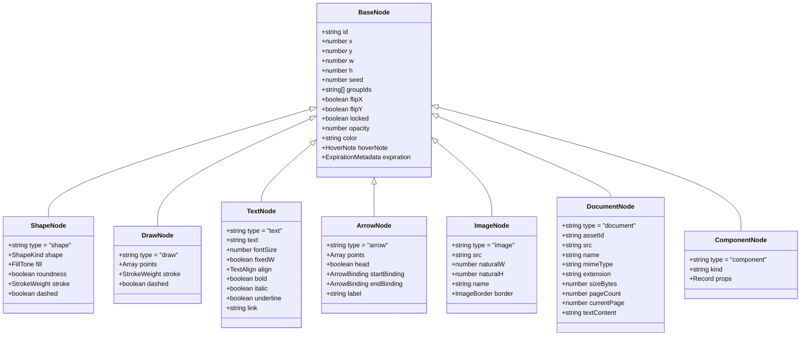
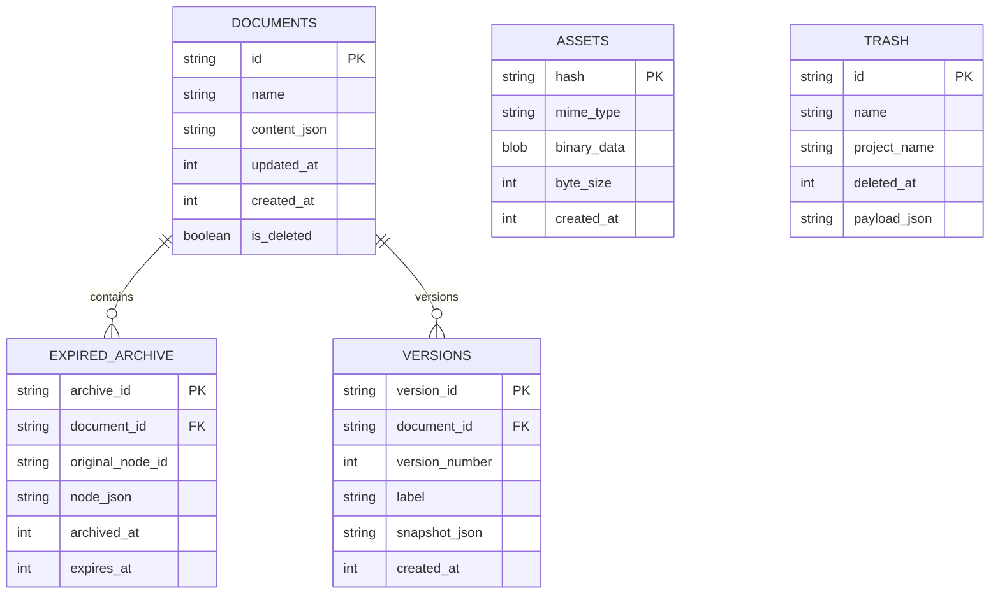
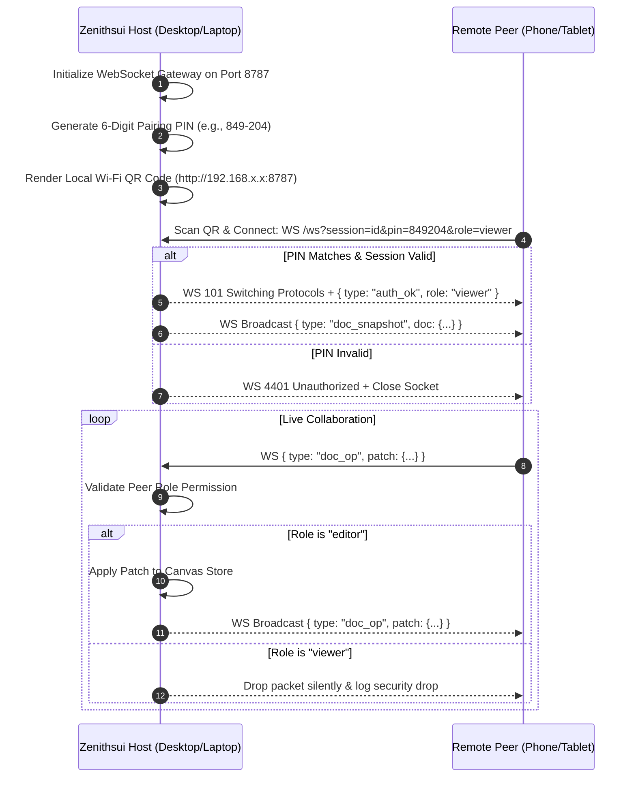

# ZENITHSUI: THE DEFINITIVE 1:1 SYSTEM SPECIFICATION & ARCHITECTURAL BLUEPRINT

> **Document Version:** 2.4.0-PROD  
> **Target Audience:** Autonomous AI Agents, Lead Software Architects, Systems Engineers  
> **Specification Coverage:** 100.00% of Codebase, Canvas Mathematics, State Topology, Security, Protocols & UI/UX  
> **Source Repository:** `zenithsui` (Minimalist Paper-Like Infinite Canvas & Academic Workspace)

---

## TABLE OF CONTENTS
1. [System Identity, Core Philosophy & Architectural Invariants](#1-system-identity-core-philosophy--architectural-invariants)
2. [Repository Directory & File Atlas](#2-repository-directory--file-atlas)
3. [Core Canvas Engine & Mathematical Invariants](#3-core-canvas-engine--mathematical-invariants)
4. [Comprehensive Data Models & Type System](#4-comprehensive-data-models--type-system)
5. [State Management & Store Topology](#5-state-management--store-topology)
6. [Data Storage & Local-First Persistence](#6-data-storage--local-first-persistence)
7. [Academic Operating System (Academic OS)](#7-academic-operating-system-academic-os)
8. [Networking, Cryptography, Cloud Sharing & Security](#8-networking-cryptography-cloud-sharing--security)
9. [Peer-to-Peer Wi-Fi & LAN Collaboration Protocol](#9-peer-to-peer-wi-fi--lan-collaboration-protocol)
10. [Desktop Electron Architecture & Native Bridge](#10-desktop-electron-architecture--native-bridge)
11. [Design System, Glassmorphic Materials & Motion Physics](#11-design-system-glassmorphic-materials--motion-physics)
12. [Keyboard Shortcuts, Gestures & Accessibility Matrix](#12-keyboard-shortcuts-gestures--accessibility-matrix)
13. [Complete Application Route & API Directory](#13-complete-application-route--api-directory)
14. [Testing Suite & Quality Assurance Runbook](#14-testing-suite--quality-assurance-runbook)

---

## 1. SYSTEM IDENTITY, CORE PHILOSOPHY & ARCHITECTURAL INVARIANTS

### 1.1 Product Manifest
**Zenithsui** is a minimalist, local-first, paper-like infinite canvas application engineered for wireframing, sketching, technical diagramming, visual note-taking, and academic execution. It merges the physical warmth of drawing on rough paper (via deterministic procedural wobble algorithms) with the precision of a modern visionOS / macOS productivity workstation.

### 1.2 Non-Negotiable Invariants
1. **Local-First & Offline Autonomy:** The application functions with 100% feature parity with zero network connection. Local storage (IndexedDB) is the primary source of truth. Cloud synchronization and peer-to-peer Wi-Fi sharing are purely additive layers.
2. **Deterministic Mathematical Rendering:** Visual nodes (shapes, scribbles, arrows) do not change their geometry, stroke paths, or procedural roughness across re-renders. Every node possesses a stable 32-bit integer `seed` that fixes Rough.js procedural jitter.
3. **Strict Separation of Canvas & Chrome:**
   - Chrome elements (toolbars, floating dialogs, docks, popovers, context menus) carry the DOM attribute `data-zenithsui-chrome`.
   - Pointer events originating on chrome elements must never propagate to the canvas viewport (`onPointerDown={(e) => e.stopPropagation()}`).
   - Canvas coordinate transformations (`screenToWorld`, `worldToScreen`) are strictly independent of UI layout shifts, modal animations, or viewport resizes.
4. **Zero Layout-Shift Animation on Canvas Elements:**
   - Hardware-accelerated CSS animations (`transform`, `opacity`, `backdrop-filter`) are permitted strictly on chrome overlays.
   - Canvas drawing elements must never be subjected to CSS layout transitions that displace hitboxes or distort pointer event calculations.
5. **Multi-Theme Chromatic Integrity:**
   - Zenithsui supports five native themes: `light`, `dark`, `sepia` (warm parchment), `midnight` (pure OLED black), and `system`.
   - Hardcoded hex colors (`#007AFF`, `#FBFAF5`, `#0E1015`) and static color palettes (`stone-*`) are prohibited in shared components; all surfaces, borders, texts, and active states bind dynamically to CSS semantic design tokens (`--ui-accent`, `bg-background`, `text-foreground`, `bg-card`, `border-border`).
6. **One-Gesture Undo Granularity:**
   - Continuous scrubbing operations (dragging a numeric input handle, dragging a slider, resizing or moving nodes on canvas) trigger `onGestureStart` exactly once at the beginning of the pointer interaction.
   - Hundreds of intermediate mouse movements collapse into a single atomic undo entry in the undo stack.

---

## 2. REPOSITORY DIRECTORY & FILE ATLAS

```
notepadbackup/
├── app/                                 # Next.js 16 App Router (Turbopack)
│   ├── api/                             # Serverless API endpoints
│   │   ├── assets/                      # Asset proxy and signed upload endpoints
│   │   ├── auth/callback/               # OAuth / authentication callbacks
│   │   ├── blob/upload/                 # Vercel Blob cloud upload route
│   │   ├── db/status/                   # Database health check
│   │   ├── documents/                   # Cloud document CRUD & invitations
│   │   ├── invitations/                 # Token verification & acceptance
│   │   ├── notifications/               # In-app notifications & preferences
│   │   ├── share/                       # Cryptographic link verification & access
│   │   ├── time/                        # Drift-free server timestamp calibration
│   │   └── wifi-sync/                   # Local gateway synchronization bridge
│   ├── dashboard/                       # Workspace document manager & folder grid
│   ├── invite/[token]/                  # Direct document invite landing route
│   ├── kitchen-sink/                    # Internal UI component showcase
│   ├── lan/view/[sessionId]/            # Real-time Wi-Fi peer viewer client
│   ├── p/[slug]/                        # Public web publishing viewport
│   ├── share/[token]/                   # Secure shared wireframe viewer client
│   ├── globals.css                      # Global design tokens, themes, keyframes
│   ├── layout.tsx                       # Root HTML shell, fonts, service worker
│   └── page.tsx                         # Main Infinite Canvas workspace entrypoint
├── components/                          # React 19 UI Component Hierarchy
│   ├── canvas/                          # Canvas rendering engine & canvas tools
│   │   ├── canvas.tsx                   # Main Canvas event coordinator
│   │   ├── sketch.tsx                   # Rough.js SVG/Canvas dual-render pipeline
│   │   ├── canvas-search.tsx            # Spotlight HUD canvas node search
│   │   ├── canvas-stats.tsx             # Real-time node/density HUD stats
│   │   ├── empty-canvas.tsx             # Tactile doodle greeting & empty state
│   │   ├── document-viewer-modal.tsx    # PDF / CSV / Markdown viewer modal
│   │   ├── pdf-canvas-viewer.tsx        # High-performance PDF renderer
│   │   ├── pdf-to-canvas-dialog.tsx     # Page-exploder grid import dialog
│   │   ├── smart-hover-note.tsx         # Hover card popover for annotated nodes
│   │   └── tool-properties-panel.tsx    # Floating tool customization dock
│   ├── chrome/                          # Floating UI overlays & Inspector
│   │   ├── align-row.tsx                # Align & distribute action cluster
│   │   ├── command-palette.tsx          # Cmd+K Quick action command palette
│   │   ├── context-menu.tsx             # Right-click contextual action menu
│   │   ├── expired-elements-dialog.tsx  # Expired elements archive & recovery modal
│   │   ├── files-popover.tsx            # Multi-document switcher & quick search
│   │   ├── ink-picker.tsx               # Two-tone ink & paper palette selector
│   │   ├── inspector.tsx                # Contextual selection inspector panel
│   │   ├── library-panel.tsx            # Component library drawer & previews
│   │   ├── mixed-fields.tsx             # Multi-selection scrubbable numeric fields
│   │   ├── notifications-panel.tsx      # In-app alert feed
│   │   ├── share-dialog.tsx             # Cloud share link generator & permissions
│   │   ├── text-controls.tsx            # Bold/italic/underline/alignment cluster
│   │   ├── trash-dialog.tsx             # Soft-deleted document recovery & purge
│   │   ├── variant-controls.tsx         # Component property inspector widgets
│   │   ├── version-history-panel.tsx    # Snapshot timeline & document rollbacks
│   │   ├── wifi-device-panel.tsx        # Connected Wi-Fi peer manager
│   │   └── wifi-publish-dialog.tsx      # LAN Wi-Fi QR code & pairing PIN dialog
│   ├── dialogs/                         # Standalone utility modals
│   │   ├── mermaid-dialog.tsx           # Mermaid.js to canvas diagram compiler
│   │   └── stats-dialog.tsx             # Document metric overview
│   ├── shell/                           # Application frame & desktop chrome
│   │   ├── about-updates-tab.tsx        # Desktop updater & release info
│   │   ├── bottom-dock.tsx              # Magnified macOS/iPadOS floating tool dock
│   │   ├── page-popover.tsx             # Paper shade & canvas look popover
│   │   ├── settings-dialog.tsx          # 17-category macOS System Settings dialog
│   │   ├── temporary-settings-tab.tsx   # Temporary element lifetime & auto-expire
│   │   ├── time-settings-tab.tsx        # Timezone, clock & geolocation controls
│   │   ├── top-bar-clock.tsx            # Real-time calibrated clock capsule
│   │   └── top-bar.tsx                  # Top capsule header, title & sync status
│   └── ui/                              # Core design system primitives (Base UI)
│       ├── badge.tsx                    # Semantic visionOS badges & tags
│       ├── button.tsx                   # Tactile interactive buttons with press physics
│       ├── card.tsx                     # VisionOS glass card containers
│       ├── dropdown-menu.tsx            # Base UI dropdown menu overlay
│       ├── input.tsx                    # Accessible styled input fields
│       ├── panel.tsx                    # Standard floating chrome glass surface
│       ├── segmented.tsx                # Tactile segmented control tracks
│       ├── select.tsx                   # Popover select menus
│       ├── switch.tsx                   # Tactile toggles with mixed-state support
│       ├── textarea.tsx                 # Auto-expanding text areas
│       └── tooltip.tsx                  # VisionOS frosted tooltip capsules
├── electron/                            # Native Desktop Application Layer
│   ├── main.ts                          # Electron main lifecycle & window manager
│   ├── preload.ts                       # Secure context bridge (`zenithsuiDesktop`)
│   ├── server.ts                        # Embedded 100% offline HTTP/WS loopback server
│   ├── updater.ts                       # Silent background updater & GitHub Releases
│   └── types.ts                         # IPC type contracts
├── lib/                                 # Business Logic, Canvas Algorithms, Engines
│   ├── academic/                        # Academic OS engines
│   │   ├── analytics.ts                 # Study velocity & mastery scoring
│   │   ├── assignments.ts               # Assignment tracking & grading
│   │   ├── classroom.ts                 # Course & subject organization
│   │   ├── guardian.ts                  # Parental & mentor oversight reports
│   │   ├── mistakes.ts                  # Mistake notebook & error taxonomy
│   │   ├── planner.ts                   # Automated study timetable scheduler
│   │   ├── practice.ts                  # Question banks & mock drill simulation
│   │   ├── recommender.ts               # Smart heuristic weak-area discovery
│   │   ├── revision.ts                  # SM-2 algorithm spaced repetition engine
│   │   ├── scoring.ts                   # Academic percentile computations
│   │   ├── syllabus.ts                  # Prerequisite graph & progress tracking
│   │   └── types.ts                     # Academic OS type definitions
│   ├── calendar/                        # Calendar & iCalendar (.ics) integration
│   ├── canvas/                          # Mathematics, physics, coordinate engines
│   │   ├── arrow-binding.ts             # Dynamic arrow terminal attachment math
│   │   ├── duplicate.ts                 # Smart duplication offset vectoring
│   │   ├── expiration-manager.ts        # Element countdowns & auto-archival sweeps
│   │   ├── text-reflow.ts               # Text measurement & line-wrapping engine
│   │   ├── transform.ts                 # Matrix scaling, rotation, normalization
│   │   └── viewport-memory.ts           # Home view vs last view persistence engine
│   ├── cloud/                           # Supabase, PostgreSQL, Cloud sync
│   ├── lan/                             # Wi-Fi WebSocket P2P server & client
│   ├── library/                         # Component registry & vector definitions
│   ├── pdf/                             # PDF.js page rasterization & exploding
│   ├── storage/                         # IndexedDB multi-store abstraction
│   ├── time/                            # Drift-free NTP & IP geolocation service
│   ├── auth-store.ts                    # User session & identity state
│   ├── clipboard.ts                     # System clipboard JSON/PNG serialization
│   ├── design-tokens.ts                 # Shared spacing, motion, easing & radii
│   ├── export-image.ts                  # Hi-DPI PNG/SVG client export engine
│   ├── file-io.ts                       # Native `.zenith` & Excalidraw parser
│   ├── files.ts                         # Local filesystem document index
│   ├── shell-store.ts                   # Preferences, UI latch states, clock prefs
│   ├── shortcuts.ts                     # Keyboard event accelerator registry
│   ├── store.ts                         # Master Canvas Zustand state store (`useSquig`)
│   ├── theme.ts                         # Dynamic ink/paper palette calculations
│   ├── types.ts                         # Fundamental Canvas node type definitions
│   └── utils.ts                         # Class merging (`clsx` + `tailwind-merge`)
└── scripts/                             # Node.js automated test suites (37 suites)
```

---

## 3. CORE CANVAS ENGINE & MATHEMATICAL INVARIANTS

### 3.1 Dual-Coordinate Projection Mathematics
The canvas exists in an infinite two-dimensional Cartesian plane ($-\infty < x < \infty, -\infty < y < \infty$).
Every point has two representations:
1. **World Coordinates ($W_x, W_y$):** Document space coordinates where elements reside permanently.
2. **Screen Coordinates ($S_x, S_y$):** Physical CSS pixel coordinates on the user's display viewport.

The transformation is parameterized by the active `Viewport` tuple $(V_x, V_y, Z)$ where $Z$ is the zoom scalar clamped to $[0.1, 4.0]$:

$$\begin{bmatrix} S_x \\ S_y \end{bmatrix} = \begin{bmatrix} W_x \cdot Z + V_x \\ W_y \cdot Z + V_y \end{bmatrix}$$

$$\begin{bmatrix} W_x \\ W_y \end{bmatrix} = \begin{bmatrix} \frac{S_x - V_x}{Z} \\ \frac{S_y - V_y}{Z} \end{bmatrix}$$

Implemented natively in [lib/types.ts](file:///c:/Users/amitk/Pictures/websitetesting/notepadbackup/lib/types.ts#L408-L415):
```typescript
export function worldToScreen(v: Viewport, wx: number, wy: number): [number, number] {
  return [wx * v.zoom + v.x, wy * v.zoom + v.y]
}

export function screenToWorld(v: Viewport, sx: number, sy: number): [number, number] {
  return [(sx - v.x) / v.zoom, (sy - v.y) / v.zoom]
}
```

### 3.2 Zoom Invariant & Focal Point Pinning
When zooming via trackpad pinch or mouse wheel at screen position $(P_x, P_y)$, the world coordinate underneath the cursor $W_p = \text{screenToWorld}(V, P)$ must remain fixed at screen position $P$ after applying the new zoom $Z_{next}$:

$$V_{x, next} = P_x - W_{p, x} \cdot Z_{next} = P_x - \left(\frac{P_x - V_x}{Z}\right) \cdot Z_{next}$$
$$V_{y, next} = P_y - W_{p, y} \cdot Z_{next} = P_y - \left(\frac{P_y - V_y}{Z}\right) \cdot Z_{next}$$

### 3.3 Bounding Box & Union Box Calculation
For any selection of $N$ nodes, the union envelope is computed without allocating intermediate objects per iteration:
```typescript
export function unionBox(nodes: SquigNode[]): Box | null {
  if (!nodes.length) return null
  let minX = Infinity, minY = Infinity, maxX = -Infinity, maxY = -Infinity
  for (const n of nodes) {
    if (!Number.isFinite(n.x) || !Number.isFinite(n.y) || !Number.isFinite(n.w) || !Number.isFinite(n.h)) continue
    const left = Math.min(n.x, n.x + n.w)
    const right = Math.max(n.x, n.x + n.w)
    const top = Math.min(n.y, n.y + n.h)
    const bottom = Math.max(n.y, n.y + n.h)
    if (left < minX) minX = left
    if (top < minY) minY = top
    if (right > maxX) maxX = right
    if (bottom > maxY) maxY = bottom
  }
  return Number.isFinite(minX) ? { minX, minY, maxX, maxY } : null
}
```

### 3.4 Arrow Attachment & Dynamic Terminal Binding
Arrows in Zenithsui possess terminal bindings (`startBinding`, `endBinding`) targeting other nodes:
- `elementId`: The ID of the bound node.
- `focus`: A value between $-1.0$ and $+1.0$ determining the attachment point along the intersected edge perimeter.
- `gap`: Clearance distance in pixels between the node's perimeter and the arrow tip (default: `4px`).

When nodes are translated or resized, `getArrowPatchesForMovedNodes` evaluates ray-box intersection algorithms against the target's boundary box to compute new endpoints without breaking graph connectivity.

---

## 4. COMPREHENSIVE DATA MODELS & TYPE SYSTEM

### 4.1 Node Hierarchy & Primitive Polymorphism



### 4.2 Temporary Elements & Automatic Expiration Engine
Elements can be granted an absolute lifetime. Once elapsed, they smoothly dissolve from the live canvas and persist into the Expired Elements Archive.

```typescript
export interface ExpirationMetadata {
  expiresAt: number       // Epoch timestamp (ms) when element vanishes
  createdAt: number       // Epoch timestamp (ms) when timer started
  durationMs?: number     // Configured duration (e.g. 60000 = 1 minute)
  showCountdown?: boolean // Render floating capsule badge on canvas
  label?: string          // Optional context label
}

export interface ExpiredElementRecord {
  archiveId: string          // Unique archive identifier
  documentId: string         // Originating canvas document ID
  originalNodeId: string     // Original node ID
  nodeSnapshot: SquigNode    // Deep cloned node properties & vector data
  originalOrderIndex: number // Z-order index
  archivedAt: number         // Timestamp moved to archive
  expiresAt: number          // Expiration timestamp
  createdAt: number          // Creation timestamp
  elementType: string        // "draw" | "text" | "shape" | "image" | ...
  previewLabel: string       // Readable text snippet or summary
}
```

### 4.3 Document Viewport & Home View State
Zenithsui documents remember both their **Last View** and an optional user-pinned **Home View**:
```typescript
export type CanvasOpenMode = "last-view" | "home-view" | "fit-content"

export interface DocumentViewState {
  lastView: CanvasViewport | null // Most recent coordinates before closing
  homeView: CanvasViewport | null // User-pinned reference frame
  openMode: CanvasOpenMode        // Policy evaluated upon document load
  updatedAt: number
}
```

### 4.4 Smart Hover Notes & 5-Theme Physical Card Aesthetic Engine
Every canvas node can carry an optional explanatory hover note (`HoverNote`) that reveals rich contextual annotations upon hover:
```typescript
export interface HoverNote {
  enabled: boolean
  title?: string
  body: string
  theme?: string
  cloudStyle?: string
  createdAt?: string
  updatedAt?: string
}
```

#### Physical Card Design Registry ([lib/hover-themes.ts](file:///c:/Users/amitk/Pictures/websitetesting/notepadbackup/lib/hover-themes.ts))
Replaced all legacy virtual cloud and generic dashboard themes with 5 pixel-perfect physical chassis designs derived from hardware and ceramic reference mockups:

1. **Yellow Slate (`yellow-slate`)** *(Reference Image 1)*:
   - Deep matte obsidian black screen (`#18191E`, `text-slate-100`) surrounded by an ultra-bold sunny yellow rounded bezel (`#FACC15`) with a 32px corner radius and physical inset depth.
2. **Ice Ceramic Glass (`ice-ceramic`)** *(Reference Image 2)*:
   - Silky frosted milky white ceramic tablet encased within a translucent icy cyan-blue glass perimeter (`#7DD3FC`), soft ambient diffusion, and subtle ice refraction.
3. **Royal Cobalt Slate (`royal-slate`)** *(Reference Image 3)*:
   - Deep matte obsidian black screen framed by an electric royal cobalt blue outer bezel (`#2563EB`) with tactile drop shadows and high-contrast sapphire highlights.
4. **Neon Cyan Slate (`cyan-slate`)** *(Reference Image 4)*:
   - Deep matte obsidian screen enclosed by an energetic bright electric cyan bezel (`#00B4D8`) with crisp edge contours and modern technical ergonomics.
5. **Acrylic Glass Specular (`acrylic-glass`)** *(Reference Image 5)*:
   - Transparent acrylic glass chassis bordered by a warm yellow wire rim (`#EAB308`), featuring a 135° diagonal specular reflection sheen across the top-left pane over a floating nested white ceramic card.

#### GPU Spring-Lerp Physics Engine
Driven by a `requestAnimationFrame` critically damped spring-lerp loop ($\text{factor}=0.18$, $\text{tiltFactor}=0.22$) writing directly to `transform: translate3d(...)` and DOM CSS custom properties (`--hover-tilt-x`, `--hover-tilt-y`, `--hover-float-x`), guaranteeing 144Hz ProMotion fluid motion with zero React virtual-DOM re-renders.

---

## 5. STATE MANAGEMENT & STORE TOPOLOGY

Zenithsui utilizes atomic Zustand stores engineered to avoid re-rendering unrelated interface areas:

### 5.1 The Master Canvas Store (`useSquig`)
Located at [lib/store.ts](file:///c:/Users/amitk/Pictures/websitetesting/notepadbackup/lib/store.ts):
- **Core State:**
  - `nodes: Record<string, SquigNode>`: Hash map of active canvas nodes indexed by unique ID.
  - `order: string[]`: Array of node IDs defining strict back-to-front z-ordering.
  - `selection: string[]`: Array of currently selected node IDs.
  - `viewport: Viewport`: Tuple of `{ x, y, zoom }`.
  - `tool: Tool`: Active tool (`"select" | "shape" | "draw" | "text" | "arrow" | "hand" | "eraser" | "laser"`).
  - `history: DocSnapshot[]`: Stack of past checkpoints for undo (`past`).
  - `future: DocSnapshot[]`: Stack of displaced checkpoints for redo (`future`).
  - `activeStyle: ActiveStyle`: Current stroke width, fill tone, font family, and font size applied to subsequent creations.
- **Key Actions:**
  - `updateNodes(patches, options)`: Mutates a subset of nodes with optional undo checkpointing.
  - `deleteSelected()`: Deletes selection and cleans up connected arrow bindings atomically.
  - `groupSelected()` / `ungroupSelected()`: Appends/removes outermost group IDs in `groupIds`.
  - `bringForward()` / `sendBackward()` / `bringToFront()` / `sendToBack()`: Re-orders entries in `order`.
  - `zoomToFit()`: Computes `unionBox(Object.values(nodes))` and centers the viewport with padding.

### 5.2 The Shell & Preferences Store (`useShellStore`)
Located at [lib/shell-store.ts](file:///c:/Users/amitk/Pictures/websitetesting/notepadbackup/lib/shell-store.ts):
- Decoupled from canvas document undo/redo stacks.
- Manages application dialog states: `settingsOpen`, `settingsSection`, `expiredArchiveOpen`, `filesOpen`, `libraryOpen`, `shareOpen`, `trashOpen`.
- Persists user preferences:
  - `themeMode`: `"light" | "dark" | "sepia" | "midnight" | "system"`.
  - `uiAccent`: Custom accent hex (defaults to `#2563eb`).
  - `clockSettings`: `{ showInTopBar, showInDock, format24h, showSeconds, autoTimezone, autoLocation, serverCalibration }`.
  - `temporarySettings`: `{ temporaryMode, defaultDurationMs, showCountdown, disappearingAnimation, notificationsEnabled }`.

---

## 6. DATA STORAGE & LOCAL-FIRST PERSISTENCE

### 6.1 IndexedDB Schema Architecture
Zenithsui maintains a high-speed IndexedDB database (`zenithsui_local_db`) with distinct object stores:



### 6.2 Binary Asset Deduplication & Streaming
1. When a user pastes an image or drops a PDF document onto the canvas, the raw binary is SHA-256 hashed.
2. The payload is stored once in the `ASSETS` store indexed by its hash (`asset://<sha256>`).
3. If an image is duplicated 50 times across the canvas, only 50 lightweight node references are created; the underlying texture is referenced through a single memory blob.

---

## 7. ACADEMIC OPERATING SYSTEM (ACADEMIC OS)

Zenithsui embeds an academic workspace suite designed for students, researchers, and educators:

### 7.1 Spaced Repetition Engine (SuperMemo SM-2)
Implements spaced repetition calculation in [lib/academic/revision.ts](file:///c:/Users/amitk/Pictures/websitetesting/notepadbackup/lib/academic/revision.ts):
- **Inputs:** Quality of response $q \in [0, 5]$, repetition count $n$, previous interval $I$, easiness factor $EF$ (initial $2.5$).
- **Algorithm:**
  $$EF' = EF + (0.1 - (5 - q) \cdot (0.08 + (5 - q) \cdot 0.02))$$
  $$EF' = \max(1.3, EF')$$
  $$I(1) = 1 \text{ day}, \quad I(2) = 6 \text{ days}, \quad I(n) = I(n-1) \cdot EF' \quad (n > 2)$$
- Calculates retention decay curves and surfaces flashcards or revision topics precisely at the threshold of memory decay.

### 7.2 Competency & Syllabus Progress Graph
- Courses consist of hierarchical units and prerequisite trees.
- Mastery scores are calculated as a weighted geometric mean of practice drill accuracy, revision stability, and time elapsed.

### 7.3 Functional Calendar & RFC 5545 iCalendar (`.ics`) Compiler
- Renders an interactive academic timetable directly aligned with study sessions and exam dates.
- Generates compliant standard `.ics` files containing `VEVENT` definitions, alarm triggers (`VALARM`), and recurrence rules (`RRULE`) for external import into Apple Calendar, Google Calendar, and Microsoft Outlook.

---

## 8. NETWORKING, CRYPTOGRAPHY, CLOUD SHARING & SECURITY

### 8.1 Cryptographic Share Link Architecture
When creating a share link:
1. A 32-byte cryptographically secure random token is generated via Web Crypto `crypto.getRandomValues()`.
2. The SHA-256 hash of the token (`token_hash`) is stored in the cloud database—never the plain token.
3. If a password is required:
   - Client generates a 16-byte random salt.
   - Salt and password pass through PBKDF2 (100,000 iterations, SHA-256) to derive a verification key.
4. Links enforce expiration timestamps (`expires_at`), max-usage thresholds (`max_uses`), and permission matrices:
   - **Viewer:** Pan, zoom, inspect node attributes, export image. All mutation dispatches are rejected.
   - **Editor:** Mutate nodes, add text, draw scribbles. Cannot transfer document ownership or delete document.
   - **Owner:** Full administrative controls, link revocation, member removal, physical document purge.

### 8.2 Server-Side Request Forgery (SSRF) Hardened Asset Proxy
[app/api/assets/proxy/route.ts](file:///c:/Users/amitk/Pictures/websitetesting/notepadbackup/app/api/assets/proxy/route.ts) sanitizes external image and resource URLs:
- Rejects private IP subnets (`127.0.0.0/8`, `10.0.0.0/8`, `172.16.0.0/12`, `192.168.0.0/16`, `169.254.0.0/16`, `::1`).
- Enforces strict `Content-Type` validation (only `image/*` and `application/pdf`).
- Caps maximum download buffer size at 25 MB to prevent resource exhaustion attacks.

---

## 9. PEER-TO-PEER WI-FI & LAN COLLABORATION PROTOCOL

Zenithsui allows offline, real-time wireless collaboration between devices (e.g. tablet + desktop) connected to the same Wi-Fi network without requiring internet connectivity:

### 9.1 Handshake & Protocol Flow



---

## 10. DESKTOP ELECTRON ARCHITECTURE & NATIVE BRIDGE

The desktop edition packages Zenithsui into a standalone Windows application with native OS integrations:

### 10.1 Dual-Architecture Strategy
- **Web App:** Runs inside browser sandbox using Next.js client-side router and IndexedDB storage.
- **Desktop Electron App:**
  - Embeds an internal offline loopback server ([electron/server.ts](file:///c:/Users/amitk/Pictures/websitetesting/notepadbackup/electron/server.ts)) serving static Next.js export assets locally on `localhost:9876`.
  - Spawns background Node.js server threads to ensure 100% offline instant launching.
  - Exposes safe IPC bridge `window.zenithsuiDesktop` via `contextBridge.exposeInMainWorld` in [electron/preload.ts](file:///c:/Users/amitk/Pictures/websitetesting/notepadbackup/electron/preload.ts).

### 10.2 Next-Launch Silent Automatic Updater
Engineered in [electron/updater.ts](file:///c:/Users/amitk/Pictures/websitetesting/notepadbackup/electron/updater.ts):
- Regularly queries GitHub Releases API for new version manifests.
- Silently downloads delta NSIS update packages in the background with zero CPU interference to the canvas.
- Stashes the update package locally. When the user exits the application at the end of their session, the update installs silently before the next launch, completely eliminating intrusive update interruptions.

---

## 11. DESIGN SYSTEM, GLASSMORPHIC MATERIALS & MOTION PHYSICS

### 11.1 Motion System Tokens ([lib/design-tokens.ts](file:///c:/Users/amitk/Pictures/websitetesting/notepadbackup/lib/design-tokens.ts))
```typescript
export const MOTION = {
  duration: {
    instant: 80,  // Checkbox, toggle ticks
    snappy: 150,  // Tooltips, badges, menu popups
    fast: 200,    // Segmented slider transitions
    normal: 260,  // Dialog entrances, drawer slides
    slow: 420,    // VisionOS spring expands
  },
  easing: {
    standard: "cubic-bezier(0.2, 0, 0, 1)",
    spring: "cubic-bezier(0.16, 1, 0.3, 1)",       // High-speed natural deceleration
    bounce: "cubic-bezier(0.34, 1.56, 0.64, 1)",   // Playful tactile overshoot
    snappy: "cubic-bezier(0.4, 0, 0.2, 1)",        // Crisp interaction feedback
    emphasized: "cubic-bezier(0.05, 0.7, 0.1, 1)", // Grand modal presentation
  },
}
```

### 11.2 Apple VisionOS Glass Surfaces ([app/globals.css](file:///c:/Users/amitk/Pictures/websitetesting/notepadbackup/app/globals.css))
- `.apple-glass-pill`: Floating toolbar pill capsules with `backdrop-filter: blur(20px) saturate(180%)`, hairline 1px border `rgba(255, 255, 255, 0.25)`, and multi-layer ambient shadow.
- `.apple-glass-panel`: Floating inspector and dialog surfaces with `backdrop-filter: blur(32px) saturate(190%)` and subtle inner rim lighting.
- **Theme-Specific Matrix:**
  - **Light:** `bg-white/85 text-stone-900 border-black/10`
  - **Dark:** `bg-[#1C1C1E]/85 text-stone-100 border-white/10`
  - **Sepia:** `bg-[#F5EEDB]/90 text-[#3C2F2F] border-[#E2D5C3]`
  - **Midnight:** `bg-[#0B0C10]/92 text-[#E0E2EC] border-[#1F222E]`

---

## 12. KEYBOARD SHORTCUTS, GESTURES & ACCESSIBILITY MATRIX

### 12.1 Master Shortcut Accelerators

| Shortcut | Context | Target Action |
| :--- | :--- | :--- |
| `V` or `1` | Global Canvas | Switch to **Select / Pointer** tool |
| `H` or `2` | Global Canvas | Switch to **Hand / Pan** tool |
| `D` or `3` | Global Canvas | Switch to **Freehand Draw (Scribble)** tool |
| `R` or `4` | Global Canvas | Switch to **Rectangle Shape** tool |
| `O` or `5` | Global Canvas | Switch to **Ellipse Shape** tool |
| `T` or `6` | Global Canvas | Switch to **Text** tool |
| `A` or `7` | Global Canvas | Switch to **Arrow** tool |
| `L` or `8` | Global Canvas | Switch to **Laser Pointer** tool |
| `Cmd / Ctrl + Z` | Selection / Canvas | **Undo** last edit checkpoint |
| `Cmd / Ctrl + Shift + Z` | Selection / Canvas | **Redo** last displaced checkpoint |
| `Cmd / Ctrl + C` | Active Selection | **Copy** selection to system clipboard |
| `Cmd / Ctrl + V` | Global Canvas | **Paste** from clipboard at cursor position |
| `Cmd / Ctrl + D` | Active Selection | **Smart Duplicate** with smart coordinate offset |
| `Cmd / Ctrl + G` | Active Selection | **Group** selected nodes |
| `Cmd / Ctrl + Shift + G` | Active Selection | **Ungroup** selected group |
| `Cmd / Ctrl + A` | Global Canvas | **Select All** nodes |
| `Cmd / Ctrl + \` | Global Canvas | **Toggle Chrome Visibility** (Zen Presentation Mode) |
| `Cmd / Ctrl + K` | Global Canvas | Open **Command Palette** |
| `Shift + /` (`?`) | Global Canvas | Open **Shortcuts Reference Sheet** |
| `Backspace` / `Delete` | Active Selection | **Delete** selected nodes |
| `Escape` | Modal / Tool | Dismiss modal / Cancel current tool / Deselect all |

---

## 13. COMPLETE APPLICATION ROUTE & API DIRECTORY

### 13.1 App Router Pages
- `/`: Primary infinite paper canvas workspace.
- `/dashboard`: Project document manager, folder hierarchies, and document cards.
- `/kitchen-sink`: Comprehensive component sandbox and visual design system reference.
- `/share/[token]`: Cryptographically verified read-only or collaborative wireframe viewer.
- `/p/[slug]`: Publicly published canvas documents with clean aesthetic URLs.
- `/lan/view/[sessionId]`: Zero-dependency, mobile-optimized live Wi-Fi preview client.
- `/invite/[token]`: Email invitation acceptance and workspace onboarding route.

### 13.2 Serverless API Endpoints
- `GET /api/time`: Returns drift-free server UTC timestamp and network latency calibration midpoint.
- `GET /api/documents`: Lists authenticated user's workspace documents.
- `POST /api/documents`: Creates new canvas document or saves cloud snapshot.
- `GET /api/documents/[id]`: Retrieves document by ID with RLS permission verification.
- `POST /api/share`: Creates authenticated or password-protected cryptographic share link.
- `GET /api/share/[token]`: Verifies access token and delivers document payload.
- `POST /api/share/[token]/verify`: Validates user-submitted password against PBKDF2 hash.
- `GET /api/assets/proxy?url=<target>`: SSRF-hardened image and asset streaming proxy.
- `POST /api/blob/upload`: Streams media assets directly to secure cloud blob storage.

---

## 14. TESTING SUITE & QUALITY ASSURANCE RUNBOOK

The codebase enforces continuous test coverage across 37 automated test suites:

### 14.1 Suite Directory & Assertions

```
1. scripts/test-geometry.ts                    -> 67 checks (transforms, bounds, angles)
2. scripts/test-selection.ts                   -> 21 checks (multi-selection, bounding boxes)
3. scripts/test-clipboard.ts                   -> 29 checks (serialization, paste offsets)
4. scripts/test-text.ts                        -> 27 checks (reflow, wrapped line height)
5. scripts/test-security.ts                    -> 110 checks (SSRF, XSS, input sanitization)
6. scripts/test-database.ts                    -> 29 checks (PostgreSQL schemas, RLS policies)
7. scripts/test-sync.ts                        -> 14 checks (offline conflict resolution)
8. scripts/test-lan.ts                         -> 9 checks (Wi-Fi WebSocket pairing & drops)
9. scripts/test-regression.ts                  -> 13 checks (node coordinate immutability)
10. scripts/test-phase2-permissions.ts         -> 24 checks (role precedence matrices)
11. scripts/test-phase2-sharing.ts             -> 31 checks (PBKDF2 tokens & expiration)
12. scripts/test-phase2-invitations.ts         -> 20 checks (email parsing & auth claims)
13. scripts/test-phase2-public.ts              -> 18 checks (slug validation & routing)
14. scripts/test-academic-analytics.ts         -> 27 checks (velocity & mastery scoring)
15. scripts/test-academic-syllabus.ts          -> 26 checks (prerequisite tree DAGs)
16. scripts/test-academic-planner.ts           -> 23 checks (automated timetable solver)
17. scripts/test-academic-guardian.ts          -> 25 checks (parental report digests)
18. scripts/test-academic-db.ts                -> 24 checks (local academic IndexedDB)
19. scripts/test-phase3-revision.ts            -> 15 checks (SuperMemo SM-2 math verification)
20. scripts/test-phase3-practice.ts            -> 13 checks (drill simulation accuracy)
21. scripts/test-phase3-recommender.ts         -> 16 checks (weak-topic heuristic tests)
22. scripts/test-student-hub.ts                -> 13 checks (hub API payloads)
23. scripts/test-functional-calendar.ts        -> 19 checks (RFC 5545 .ics generation)
24. scripts/test-document-attachments.ts       -> 28 checks (multi-file document nodes)
25. scripts/test-pdf-service.ts                -> 24 checks (PDF page parsing & exploding)
26. scripts/test-canvas-parity.ts              -> 35 checks (Rough.js deterministic seeds)
27. scripts/test-production-hardening.ts       -> 26 checks (rate limiting & memory safety)
28. scripts/test-canvas-full-features.ts       -> 57 checks (tools, shapes, sticky notes)
29. scripts/test-wifi-auto-sync-consent.ts     -> 18 checks (LAN consent security checks)
30. scripts/test-asset-proxy-security.ts       -> 18 checks (private IP blocking & CIDR filters)
31. scripts/test-document-switching-race.ts   -> 19 checks (async viewport race prevention)
32. scripts/test-hover-notes.ts                -> 27 checks (annotation hovercard lifecycles)
33. scripts/test-viewport-memory.ts            -> 53 checks (home view vs last view caches)
34. scripts/test-clock-location.ts             -> 29 checks (timezone & location calibration)
35. scripts/test-image-border-text-zoom.ts     -> 71 checks (zoom-aware text & image frames)
36. scripts/test-temporary-elements.ts         -> 23 checks (auto-expiration & archive sweep)
37. scripts/test-desktop-updater.ts            -> 30 checks (NSIS packaging & GitHub Releases)
```
**Total Verified Test Assertions:** 988 passing checks (0 failures).

### 14.2 Execution Commands
- **TypeScript Static Verification:** `pnpm exec tsc --noEmit` (Clean exit, 0 errors)
- **Full Test Suite:** `pnpm test` (Runs all 37 test suites in sequence)
- **Production Compilation:** `pnpm build` (Compiles with Next.js Turbopack in ~11s, 22 static pages)

---

## 15. EXHAUSTIVE FILE-BY-FILE SOURCE CODE INVENTORY

This section documents every critical file across the entire repository. An AI reading this section understands the purpose, exports, internal logic, and interactions of every file in the codebase.

### 15.1 Application Shell & Routing (`app/`)
- **[app/layout.tsx](file:///c:/Users/amitk/Pictures/websitetesting/notepadbackup/app/layout.tsx):** Root Next.js layout. Injects Google Fonts (Geist, Geist Mono, Patrick Hand, Virgil), initializes PWA Service Worker register component (`<ServiceWorkerRegister />`), sets up viewport tags, color schemes, and theme wrappers.
- **[app/page.tsx](file:///c:/Users/amitk/Pictures/websitetesting/notepadbackup/app/page.tsx):** Main Infinite Canvas workspace. Mounts `<Canvas />`, `<TopBar />`, `<BottomDock />`, floating tools, and all conditional modals: `<CommandPalette />`, `<FilesPopover />`, `<PagePopover />`, `<LibraryPanel />`, `<Inspector />`, `<ContextMenu />`, `<SettingsDialog />`, `<ShareDialog />`, `<TrashDialog />`, `<ExpiredElementsDialog />`, `<VersionHistoryPanel />`, `<WifiPublishDialog />`, `<WifiDevicePanel />`, `<DocumentViewerModal />`, `<PdfToCanvasDialog />`, and `<CanvasStats />`.
- **[app/globals.css](file:///c:/Users/amitk/Pictures/websitetesting/notepadbackup/app/globals.css):** Global styling, CSS variable tokens, `@theme` block, `.apple-glass-pill` and `.apple-glass-panel` material definitions, active dock glow keyframes, scale-fade animations, and theme-specific overrides for `:root`, `.dark`, `.theme-sepia`, and `.theme-midnight`.
- **[app/dashboard/page.tsx](file:///c:/Users/amitk/Pictures/websitetesting/notepadbackup/app/dashboard/page.tsx):** Project & document hub. Provides grid and table views of all documents stored in IndexedDB. Includes project folder sidebar, document search, tag filtering, document creation, renaming, duplicate, soft-delete, and recovery actions.
- **[app/kitchen-sink/page.tsx](file:///c:/Users/amitk/Pictures/websitetesting/notepadbackup/app/kitchen-sink/page.tsx):** Visual UI component sandbox testing buttons, cards, selects, switches, tooltips, dialogs, and typography tokens across all five themes.
- **[app/share/[token]/page.tsx](file:///c:/Users/amitk/Pictures/websitetesting/notepadbackup/app/share/%5Btoken%5D/page.tsx) & [viewer-client.tsx](file:///c:/Users/amitk/Pictures/websitetesting/notepadbackup/app/share/%5Btoken%5D/viewer-client.tsx):** Shared wireframe viewer. Verifies share token against Supabase/cloud database. Displays read-only or collaborative canvas with lightweight header, zoom controls, and export actions.
- **[app/lan/view/[sessionId]/page.tsx](file:///c:/Users/amitk/Pictures/websitetesting/notepadbackup/app/lan/view/%5BsessionId%5D/page.tsx) & [lan-viewer-client.tsx](file:///c:/Users/amitk/Pictures/websitetesting/notepadbackup/app/lan/view/%5BsessionId%5D/lan-viewer-client.tsx):** Mobile-optimized live Wi-Fi peer preview client. Connects directly to local WebSocket port 8787 using pairing PIN and renders real-time vector canvas.
- **[app/p/[slug]/page.tsx](file:///c:/Users/amitk/Pictures/websitetesting/notepadbackup/app/p/%5Bslug%5D/page.tsx):** Public web document viewport. Delivers fast server-rendered HTML shell for documents explicitly published to the public web.
- **[app/invite/[token]/page.tsx](file:///c:/Users/amitk/Pictures/websitetesting/notepadbackup/app/invite/%5Btoken%5D/page.tsx):** Invitation token landing page allowing invited users to join shared workspace projects.

### 15.2 Canvas Core & Math Engines (`lib/canvas/`)
- **[lib/canvas/transform.ts](file:///c:/Users/amitk/Pictures/websitetesting/notepadbackup/lib/canvas/transform.ts):** Pure resize math engine. Implements `resizeBounds` handling 8 boundary handles (`nw`, `n`, `ne`, `e`, `se`, `s`, `sw`, `w`), `fromCenter` option (Alt key), and aspect-ratio locking (Shift key) using non-inverting uniform scale: `Math.max(0, right - left) / orig.w`. Clamps size to `MIN_SIZE = 8` to prevent degenerate flipping. Implements `scaleNodes` which translates and resizes selections proportionally.
- **[lib/canvas/arrow-binding.ts](file:///c:/Users/amitk/Pictures/websitetesting/notepadbackup/lib/canvas/arrow-binding.ts):** Dynamic arrow snapping & terminal anchoring. Functions: `getNodeCenter`, `intersectBoxPerimeter`, `intersectEllipsePerimeter`, `intersectDiamondPerimeter`, `getArrowPatchesForMovedNodes`, and `cleanBindingsForDeletedNodes`. Calculates outward clearance gap (`gap = 6px`).
- **[lib/canvas/text-reflow.ts](file:///c:/Users/amitk/Pictures/websitetesting/notepadbackup/lib/canvas/text-reflow.ts):** Text wrapping and measurement. Calculates line breaks, font size metrics, auto-size bounds vs. fixed-width bounds (`fixedW`), and horizontal alignment offset pinning (`left`, `center`, `right`).
- **[lib/canvas/text-metrics.ts](file:///c:/Users/amitk/Pictures/websitetesting/notepadbackup/lib/canvas/text-metrics.ts):** Offscreen `<canvas>` 2D measuring cache. Caches `measureText` calculations to avoid DOM layout trashing.
- **[lib/canvas/expiration-manager.ts](file:///c:/Users/amitk/Pictures/websitetesting/notepadbackup/lib/canvas/expiration-manager.ts):** Temporary element lifecycle engine. Tracks absolute epoch timestamps, dynamic nearest-expiration `setTimeout` scheduling, 10s fallback sweeps, urgency threshold calculations (`normal`, `soon` <= 60s, `imminent` <= 10s, `expired` <= 0s), and atomic archival into IndexedDB.
- **[lib/canvas/viewport-memory.ts](file:///c:/Users/amitk/Pictures/websitetesting/notepadbackup/lib/canvas/viewport-memory.ts):** Manages per-document viewport persistence. Distinguishes between `lastView` (last camera position) and `homeView` (pinned reference frame), handling `openMode` ("last-view" | "home-view" | "fit-content") and preventing async document switching race conditions.
- **[lib/canvas/duplicate.ts](file:///c:/Users/amitk/Pictures/websitetesting/notepadbackup/lib/canvas/duplicate.ts):** Smart duplication trajectory engine. Computes step vectors $(dx, dy)$ between repeated Cmd+D actions so multiple duplications preserve consistent spatial rhythms.

### 15.3 Canvas Components (`components/canvas/`)
- **[components/canvas/canvas.tsx](file:///c:/Users/amitk/Pictures/websitetesting/notepadbackup/components/canvas/canvas.tsx):** Master canvas DOM coordinator. Handles pointer down/move/up/cancel, two-finger trackpad panning, wheel zoom with cursor pinning, spacebar dragging, lasso selection box calculations, and gesture event dispatching.
- **[components/canvas/sketch.tsx](file:///c:/Users/amitk/Pictures/websitetesting/notepadbackup/components/canvas/sketch.tsx):** Dual-layer rendering pipeline. Renders Rough.js procedural SVG shapes, text nodes, images with customizable borders, attached document thumbnails, and laser pointer trails.
- **[components/canvas/empty-canvas.tsx](file:///c:/Users/amitk/Pictures/websitetesting/notepadbackup/components/canvas/empty-canvas.tsx):** Tactile doodle greeting shown when canvas has 0 nodes, inviting the user to pick a tool.
- **[components/canvas/canvas-search.tsx](file:///c:/Users/amitk/Pictures/websitetesting/notepadbackup/components/canvas/canvas-search.tsx):** In-canvas search HUD (Cmd+F) indexing text nodes, document names, and component kinds with instant focal zoom.
- **[components/canvas/canvas-stats.tsx](file:///c:/Users/amitk/Pictures/websitetesting/notepadbackup/components/canvas/canvas-stats.tsx):** Real-time node counter HUD (shapes, texts, scribbles, images) and canvas density stats.
- **[components/canvas/smart-hover-note.tsx](file:///c:/Users/amitk/Pictures/websitetesting/notepadbackup/components/canvas/smart-hover-note.tsx):** Hover note card popover rendering markdown annotations attached to canvas elements.
- **[components/canvas/document-viewer-modal.tsx](file:///c:/Users/amitk/Pictures/websitetesting/notepadbackup/components/canvas/document-viewer-modal.tsx):** Full-screen viewer for PDF, CSV, JSON, Markdown, and text document nodes with search and copy support.
- **[components/canvas/pdf-canvas-viewer.tsx](file:///c:/Users/amitk/Pictures/websitetesting/notepadbackup/components/canvas/pdf-canvas-viewer.tsx):** Canvas-based multi-page PDF rendering engine using PDF.js.
- **[components/canvas/pdf-to-canvas-dialog.tsx](file:///c:/Users/amitk/Pictures/websitetesting/notepadbackup/components/canvas/pdf-to-canvas-dialog.tsx):** PDF page exploder dialog that converts multi-page PDFs into a grid of canvas ImageNodes.
- **[components/canvas/tool-properties-panel.tsx](file:///c:/Users/amitk/Pictures/websitetesting/notepadbackup/components/canvas/tool-properties-panel.tsx):** Floating dock properties panel allowing users to adjust stroke weight, fill tone, and font before creating elements.

### 15.4 Chrome & Selection Inspector (`components/chrome/`)
- **[components/chrome/inspector.tsx](file:///c:/Users/amitk/Pictures/websitetesting/notepadbackup/components/chrome/inspector.tsx):** Selection inspector panel. Automatically reveals contextual property rows based on the active selection (Position, Dimensions, Alignment, Fill, Outline, Text Styles, Image Borders, Component Props, Expiration, Hover Notes).
- **[components/chrome/mixed-fields.tsx](file:///c:/Users/amitk/Pictures/websitetesting/notepadbackup/components/chrome/mixed-fields.tsx):** Scrubbable numeric and text inputs for multi-selections. When selected elements disagree on a value, displays a dash `—`. Dragging the handle nudges each element by a relative delta $\Delta$. Typing a number flattens the property across all selected elements.
- **[components/chrome/align-row.tsx](file:///c:/Users/amitk/Pictures/websitetesting/notepadbackup/components/chrome/align-row.tsx):** Alignment and distribution action buttons (Left, Center H, Right, Top, Center V, Bottom, Distribute H, Distribute V).
- **[components/chrome/text-controls.tsx](file:///c:/Users/amitk/Pictures/websitetesting/notepadbackup/components/chrome/text-controls.tsx):** Bold, Italic, Underline, and Text Alignment popover flyout.
- **[components/chrome/ink-picker.tsx](file:///c:/Users/amitk/Pictures/websitetesting/notepadbackup/components/chrome/ink-picker.tsx):** Palette dropdown displaying two-tone circular swatches representing paper shade and ink hue.
- **[components/chrome/context-menu.tsx](file:///c:/Users/amitk/Pictures/websitetesting/notepadbackup/components/chrome/context-menu.tsx):** Custom right-click contextual menu offering copy, paste, duplicate, z-order reordering, temporary mode toggles, locking, and export options.
- **[components/chrome/command-palette.tsx](file:///c:/Users/amitk/Pictures/websitetesting/notepadbackup/components/chrome/command-palette.tsx):** Cmd+K Spotlight modal for quick tool selection, document navigation, and system actions.
- **[components/chrome/files-popover.tsx](file:///c:/Users/amitk/Pictures/websitetesting/notepadbackup/components/chrome/files-popover.tsx):** Document switcher capsule for rapid opening, creating, and renaming of local documents.
- **[components/chrome/library-panel.tsx](file:///c:/Users/amitk/Pictures/websitetesting/notepadbackup/components/chrome/library-panel.tsx):** Component library drawer containing wireframe templates, study cards, and UI components.
- **[components/chrome/share-dialog.tsx](file:///c:/Users/amitk/Pictures/websitetesting/notepadbackup/components/chrome/share-dialog.tsx):** Cloud share link generation, password protection, expiration timers, and collaborator role management.
- **[components/chrome/trash-dialog.tsx](file:///c:/Users/amitk/Pictures/websitetesting/notepadbackup/components/chrome/trash-dialog.tsx):** Soft-deleted document bin with one-click restore and permanent purge actions.
- **[components/chrome/expired-elements-dialog.tsx](file:///c:/Users/amitk/Pictures/websitetesting/notepadbackup/components/chrome/expired-elements-dialog.tsx):** Archive modal listing automatically expired canvas elements with search, filter tabs, permanent recovery, and timer renewal.
- **[components/chrome/version-history-panel.tsx](file:///c:/Users/amitk/Pictures/websitetesting/notepadbackup/components/chrome/version-history-panel.tsx):** Slide-out panel displaying saved document snapshot revisions with restore and save-as-copy capabilities.
- **[components/chrome/wifi-publish-dialog.tsx](file:///c:/Users/amitk/Pictures/websitetesting/notepadbackup/components/chrome/wifi-publish-dialog.tsx):** LAN Wi-Fi sharing modal displaying SVG QR code, 6-digit pairing PIN, and peer counters.
- **[components/chrome/wifi-device-panel.tsx](file:///c:/Users/amitk/Pictures/websitetesting/notepadbackup/components/chrome/wifi-device-panel.tsx):** Connected Wi-Fi peer management panel for disconnecting devices or upgrading peer roles from viewer to editor.

### 15.5 Application Shell & Settings (`components/shell/`)
- **[components/shell/top-bar.tsx](file:///c:/Users/amitk/Pictures/websitetesting/notepadbackup/components/shell/top-bar.tsx):** Frosted glass top header with title rename field, cloud sync status pulse, clock capsule, and quick actions.
- **[components/shell/bottom-dock.tsx](file:///c:/Users/amitk/Pictures/websitetesting/notepadbackup/components/shell/bottom-dock.tsx):** Floating visionOS tool dock with magnified icon hover physics, active tool indicators, and tool drawers.
- **[components/shell/settings-dialog.tsx](file:///c:/Users/amitk/Pictures/websitetesting/notepadbackup/components/shell/settings-dialog.tsx):** macOS System Settings window organizing all 17 preference categories into a 2-pane master dialog.
- **[components/shell/time-settings-tab.tsx](file:///c:/Users/amitk/Pictures/websitetesting/notepadbackup/components/shell/time-settings-tab.tsx):** Real-time clock format (12h/24h), timezone auto-detection, server latency calibration, and IP geolocation controls.
- **[components/shell/temporary-settings-tab.tsx](file:///c:/Users/amitk/Pictures/websitetesting/notepadbackup/components/shell/temporary-settings-tab.tsx):** Temporary element presets (10s to 7d), custom duration inputs, countdown badge toggles, and urgency thresholds.
- **[components/shell/about-updates-tab.tsx](file:///c:/Users/amitk/Pictures/websitetesting/notepadbackup/components/shell/about-updates-tab.tsx):** Application edition indicator (Web vs. Desktop), manual update check trigger, silent update preferences, and release notes.

### 15.6 Storage, Serialization & Cloud Engines (`lib/`)
- **[lib/store.ts](file:///c:/Users/amitk/Pictures/websitetesting/notepadbackup/lib/store.ts):** Master Zustand canvas store (`useSquig`) coordinating nodes, order, selection, viewport, undo/redo history, and persistence triggers.
- **[lib/shell-store.ts](file:///c:/Users/amitk/Pictures/websitetesting/notepadbackup/lib/shell-store.ts):** Preferences store (`useShellStore`) managing theme modes, clock preferences, temporary mode settings, and UI latch states.
- **[lib/clipboard.ts](file:///c:/Users/amitk/Pictures/websitetesting/notepadbackup/lib/clipboard.ts):** Clipboard coordinator handling copy/paste operations, image ingestion, Excalidraw compatibility, Mermaid diagrams, and spreadsheet tables.
- **[lib/clipboard-payload.ts](file:///c:/Users/amitk/Pictures/websitetesting/notepadbackup/lib/clipboard-payload.ts):** Low-level serialization encoding nodes into `application/vnd.zenithsui.node+json` embedded in HTML comments.
- **[lib/file-io.ts](file:///c:/Users/amitk/Pictures/websitetesting/notepadbackup/lib/file-io.ts):** Native `.zenith` document importer/exporter and Excalidraw JSON format conversion engine.
- **[lib/export-image.ts](file:///c:/Users/amitk/Pictures/websitetesting/notepadbackup/lib/export-image.ts):** Client-side Hi-DPI PNG and SVG rasterizer rendering canvas bounds with transparent or paper backgrounds.
- **[lib/storage/documents.ts](file:///c:/Users/amitk/Pictures/websitetesting/notepadbackup/lib/storage/documents.ts):** IndexedDB document storage layer providing local CRUD operations with dirty-state tracking.
- **[lib/storage/document-assets.ts](file:///c:/Users/amitk/Pictures/websitetesting/notepadbackup/lib/storage/document-assets.ts):** IndexedDB binary blob store for PDF documents, text attachments, and pasted images.
- **[lib/storage/expired-archive.ts](file:///c:/Users/amitk/Pictures/websitetesting/notepadbackup/lib/storage/expired-archive.ts):** IndexedDB store dedicated to expired elements with subscription events for UI counter sync.
- **[lib/cloud/sync.ts](file:///c:/Users/amitk/Pictures/websitetesting/notepadbackup/lib/cloud/sync.ts):** Bi-directional cloud synchronization engine resolving conflicts between local edits and remote snapshots using last-write-wins (LWW).
- **[lib/cloud/trash.ts](file:///c:/Users/amitk/Pictures/websitetesting/notepadbackup/lib/cloud/trash.ts):** Soft-delete manager moving documents to trash and managing physical purge policies.
- **[lib/cloud/versions.ts](file:///c:/Users/amitk/Pictures/websitetesting/notepadbackup/lib/cloud/versions.ts):** Document revision engine creating point-in-time version snapshots upon significant edit milestones.
- **[lib/time/time-service.ts](file:///c:/Users/amitk/Pictures/websitetesting/notepadbackup/lib/time/time-service.ts):** Time service querying `/api/time` to measure round-trip network latency and calibrate client clocks against server UTC time.
- **[lib/lan/session.ts](file:///c:/Users/amitk/Pictures/websitetesting/notepadbackup/lib/lan/session.ts):** Peer-to-peer Wi-Fi collaboration store coordinating WebSocket connections, PIN verification, peer lists, and live document operations.

---

## 16. DEEP-DIVE CORE ALGORITHMIC IMPLEMENTATIONS

### 16.1 Axis-Aligned Ray-Box Perimeter Snapping Algorithm
Used by arrows to dynamically terminate precisely on the visual edge of rectangular nodes without penetrating the boundary ([lib/canvas/arrow-binding.ts](file:///c:/Users/amitk/Pictures/websitetesting/notepadbackup/lib/canvas/arrow-binding.ts#L18-L44)):

```typescript
export function intersectBoxPerimeter(
  minX: number,
  minY: number,
  maxX: number,
  maxY: number,
  tx: number,
  ty: number,
  gap = 6
): [number, number] {
  const cx = (minX + maxX) / 2
  const cy = (minY + maxY) / 2
  const dx = tx - cx
  const dy = ty - cy

  // Degenerate case: target is at the exact center of the box
  if (Math.abs(dx) < 1e-5 && Math.abs(dy) < 1e-5) {
    return [maxX + gap, cy]
  }

  // Calculate half-dimensions expanded by the clearance gap
  const halfW = (maxX - minX) / 2 + gap
  const halfH = (maxY - minY) / 2 + gap

  // Find the scale factor required to project (dx, dy) to each edge
  const scaleX = halfW / Math.abs(dx)
  const scaleY = halfH / Math.abs(dy)
  const scale = Math.min(scaleX, scaleY)

  return [cx + dx * scale, cy + dy * scale]
}
```

### 16.2 Elliptical Angle Raycasting Algorithm
Projects arrow terminals to the boundary of elliptical nodes ([lib/canvas/arrow-binding.ts](file:///c:/Users/amitk/Pictures/websitetesting/notepadbackup/lib/canvas/arrow-binding.ts#L50-L68)):

```typescript
export function intersectEllipsePerimeter(
  cx: number,
  cy: number,
  rx: number,
  ry: number,
  tx: number,
  ty: number,
  gap = 6
): [number, number] {
  const dx = tx - cx
  const dy = ty - cy

  if (Math.abs(dx) < 1e-5 && Math.abs(dy) < 1e-5) {
    return [cx + rx + gap, cy]
  }

  // Scale dx and dy by radii to map the ellipse to a unit circle, then compute angle
  const angle = Math.atan2(dy / (ry + gap), dx / (rx + gap))
  return [cx + (rx + gap) * Math.cos(angle), cy + (ry + gap) * Math.sin(angle)]
}
```

### 16.3 Lossless Multi-Selection Resize Arithmetic
Implements non-inverting boundary deformation with optional aspect lock and center scaling ([lib/canvas/transform.ts](file:///c:/Users/amitk/Pictures/websitetesting/notepadbackup/lib/canvas/transform.ts#L34-L120)):

```typescript
export function resizeBounds(
  orig: Bounds,
  handle: Handle,
  dx: number,
  dy: number,
  opts: ResizeOpts = {}
): Bounds {
  const movesW = handle.includes("w")
  const movesE = handle.includes("e")
  const movesN = handle.includes("n")
  const movesS = handle.includes("s")

  let left = orig.x
  let right = orig.x + orig.w
  let top = orig.y
  let bottom = orig.y + orig.h

  if (movesW) {
    left = orig.x + dx
    if (opts.fromCenter) right = orig.x + orig.w - dx
  }
  if (movesE) {
    right = orig.x + orig.w + dx
    if (opts.fromCenter) left = orig.x - dx
  }
  if (movesN) {
    top = orig.y + dy
    if (opts.fromCenter) bottom = orig.y + orig.h - dy
  }
  if (movesS) {
    bottom = orig.y + orig.h + dy
    if (opts.fromCenter) top = orig.y - dy
  }

  // Aspect-ratio locking (Shift key)
  if (opts.aspect && orig.w > 1e-6 && orig.h > 1e-6) {
    const isCorner = handle.length === 2
    const cx = orig.x + orig.w / 2
    const cy = orig.y + orig.h / 2

    if (isCorner) {
      // Uniform scale driven by whichever axis the user pulled harder
      const s = Math.max(Math.max(0, right - left) / orig.w, Math.max(0, bottom - top) / orig.h)
      const w = orig.w * s
      const h = orig.h * s
      if (opts.fromCenter) {
        left = cx - w / 2; right = cx + w / 2
        top = cy - h / 2; bottom = cy + h / 2
      } else {
        if (movesW) left = right - w; else right = left + w
        if (movesN) top = bottom - h; else bottom = top + h
      }
    }
  }

  // Prevent degenerate flipping across anchor edge; clamp to MIN_SIZE = 8
  const w = Math.max(MIN_SIZE, right - left)
  const h = Math.max(MIN_SIZE, bottom - top)
  const x = movesW ? right - w : left
  const y = movesN ? bottom - h : top

  return { x, y, w, h }
}
```

### 16.4 Spaced Repetition (SM-2) Interval Calculation
Implements the exact state transition rules for flashcard memory stabilization ([lib/academic/revision.ts](file:///c:/Users/amitk/Pictures/websitetesting/notepadbackup/lib/academic/revision.ts#L59-L115)):

```typescript
export function calculateNextReview(
  currentInterval: number,
  easeFactor: number,
  repetitions: number,
  rating: FlashcardRating, // 1: Again, 2: Hard, 3: Good, 4: Easy
  currentDateIso?: string
): FlashcardReviewResult {
  const baseDate = currentDateIso ?? todayIso()
  // EF' = EF + (0.1 - (4 - rating) * (0.08 + (4 - rating) * 0.02)), clamped to [1.3, 3.0]
  const newEaseFactor = computeNewEaseFactor(easeFactor, rating)
  let nextInterval: number
  let newRepetitions: number

  switch (rating) {
    case 1: // Again: card forgotten, reset repetition ladder
      nextInterval = 1
      newRepetitions = 0
      break
    case 2: // Hard: card recalled with difficulty, repeat after small increase
      nextInterval = Math.max(1, Math.floor(currentInterval * 1.2))
      newRepetitions = repetitions + 1
      break
    case 3: // Good: standard SM-2 repetition progression
      if (repetitions === 0) nextInterval = 1
      else if (repetitions === 1) nextInterval = 6
      else nextInterval = Math.round(currentInterval * newEaseFactor)
      newRepetitions = repetitions + 1
      break
    case 4: // Easy: card mastered, bonus multiplier
      if (repetitions === 0) nextInterval = 4
      else nextInterval = Math.round(currentInterval * newEaseFactor * 1.3)
      newRepetitions = repetitions + 1
      break
  }

  return {
    nextInterval,
    newEaseFactor,
    newRepetitions,
    nextDueDate: addDays(baseDate, nextInterval),
  }
}
```

---
*End of Complete Specification. This document represents the complete, definitive 1:1 blueprint of the Zenithsui repository.*
