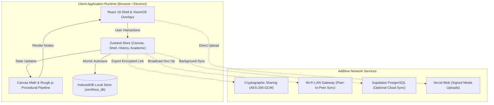
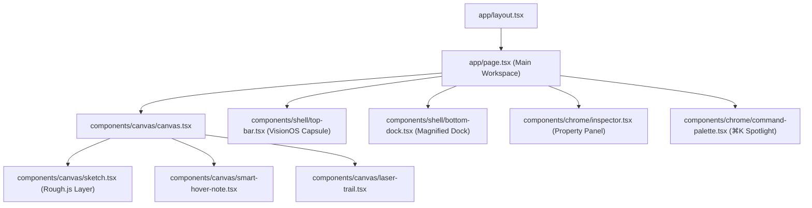
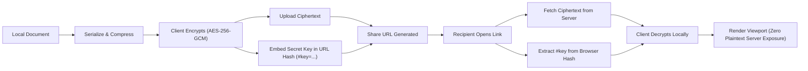

# Zenithsui Architecture Specification

This document provides a comprehensive technical breakdown of **Zenithsui**'s system topology, coordinate mathematics, persistence layers, component hierarchy, and security boundaries.

---

## 1. High-Level System Architecture

Zenithsui is constructed as a **local-first, paper-like infinite canvas workstation**. The client runtime operates entirely in the browser using React 19, Next.js 16 App Router, Zustand 5, and Rough.js, backed by IndexedDB. Cloud synchronization and peer-to-peer Wi-Fi collaboration serve as optional additive layers.

---

## 2. Component Hierarchy & Separation of Concerns

Zenithsui enforces a strict boundary between the **Canvas Viewport** and the **Application Chrome**:

- **Canvas Viewport (`components/canvas/`)**:
  - Handles infinite panning, zooming, mouse gestures, multi-selection bounding boxes, and procedural Rough.js shape rendering.
  - Coordinate system operates in virtual **world coordinates** $(\mathbb{R}^2)$.
- **Chrome Overlays (`components/chrome/`, `components/shell/`)**:
  - Floating top-bar capsule (`top-bar.tsx`), liquid glass dock (`bottom-dock.tsx`), property inspector (`inspector.tsx`), and modal dialogs.
  - Carries the DOM attribute `data-zenithsui-chrome`.
  - All pointer events stop propagation to avoid inadvertently selecting, dragging, or deselecting canvas nodes during UI clicks.

---

## 3. Canvas Mathematical Engine & Coordinate Transformation

The canvas operates on an infinite 2D plane with zoom factor $z \in [0.1, 5.0]$ and viewport offset $(v_x, v_y)$.

### Coordinate Transformations

#### Screen to World
Transforms mouse/pointer event coordinates $(s_x, s_y)$ relative to the canvas DOM element into world coordinates $(w_x, w_y)$:

$$w_x = \frac{s_x - v_x}{z}$$
$$w_y = \frac{s_y - v_y}{z}$$

#### World to Screen
Transforms a node's stored position in the document model $(w_x, w_y)$ into screen pixel coordinates $(s_x, s_y)$:

$$s_x = w_x \cdot z + v_x$$
$$s_y = w_y \cdot z + v_y$$

### Seed Determinism
Every procedural sketch node contains a 32-bit integer `seed`. This seed initializes Rough.js's pseudo-random number generator, ensuring that hand-drawn lines, corner wobbles, and hachure fills remain identical across re-renders, viewport pans, exports, and document reloads.

---

## 4. Local-First Persistence & Storage Architecture

Zenithsui stores documents primarily in client-side **IndexedDB** (`zenithsui_db`).

```mermaid
sequenceDiagram
    participant User as User Gesture
    participant Store as Canvas Store (Zustand)
    participant DB as IndexedDB (zenithsui_db)
    participant Cloud as Cloud Sync (Optional)

    User->>Store: Move node / draw stroke
    Store->>Store: Update memory state (0ms latency)
    Store-->>User: Immediate visual update
    
    rect rgb(30, 41, 59)
        Note over Store,DB: Debounced Autosave (150ms)
        Store->>DB: Put document transaction (atomic)
        DB-->>Store: Transaction committed
    end

    opt Cloud Sync Enabled
        Store->>Cloud: POST /api/documents (background sync)
        Cloud-->>Store: 200 OK (synced)
    end
```

### IndexedDB Object Stores (`zenithsui_db` v2)
1. `documents`: Serialized document JSON payloads with nodes, viewport states, metadata, and timestamps.
2. `viewports`: Per-document viewport memory (pan $x, y$ and zoom $z$) to restore exact viewing location upon document switching.
3. `assets`: Local binary cache of embedded images and PDFs (keyed by SHA-256 hash).
4. `academic_records`: Local records for academic syllabus, planner events, and revision cards.

---

## 5. Cryptographic Sharing Architecture

Documents can be shared via cryptographic, tamper-proof share links without storing unencrypted files on third-party servers:

- **Algorithm**: AES-GCM 256-bit with authenticated integrity tags.
- **Key Storage**: The decryption key is contained strictly within the URL anchor (`#key=...`), which is never transmitted to the host server in HTTP headers (RFC 3986).

---

## 6. Peer-to-Peer Wi-Fi & LAN Collaboration

Zenithsui includes a lightweight, zero-cloud collaboration protocol over local Wi-Fi:
- **Architecture**: A peer host broadcasts an ephemeral session token on the local network (`/api/wifi-sync`).
- **Authorization**: Joining peers must authenticate using the session PIN or pre-shared Wi-Fi gateway secret (`ZENITHSUI_GATEWAY_SECRET`).
- **Permissions**: Peers connect as either `editor` or `viewer`. Viewer attempts to inject document operations (`doc_op`) are rejected and dropped by the security layer.

---

## 7. Desktop Native Architecture (Electron)

Zenithsui bundles as a standalone native Windows desktop application (NSIS installer and portable executable):
- **Process Isolation**: The main process (`electron/main.ts`) runs in a privileged Node.js environment.
- **Renderer Isolation**: The UI runs inside Chromium with `contextIsolation: true` and `nodeIntegration: false`.
- **Preload Bridge**: Communication occurs via typed, IPC-whitelisted methods exposed through `window.zenithsuiDesktop`.
- **Auto-Updater**: Integrates `electron-updater` to check for and install GitHub release assets seamlessly.
