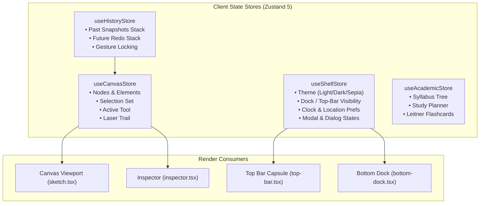

# Zenithsui Data Flow & State Topology

This document outlines the state management architecture, store separation, and unidirectional data flow in **Zenithsui**.

---

## 1. Store Topology (Zustand 5)

Zenithsui separates its client state into isolated, single-responsibility **Zustand** stores to prevent unnecessary component re-rendering:

---

## 2. Unidirectional Action Flow

1. **User Action**: The user clicks, drags, or triggers a keyboard shortcut.
2. **Gesture Boundary**:
   - `onGestureStart()` records a checkpoint in `HistoryStore` and flags `isInteracting = true`.
3. **Live State Mutation**: Continuous pointer events mutate in-memory element records directly in `CanvasStore` (60 FPS feedback without intermediate history entries).
4. **Gesture Commit**:
   - On pointerup, `commitGesture()` finalizes the operation, calculates bounding box changes, and triggers the debounced IndexedDB autosave.
5. **Persistence**:
   - IndexedDB receives the serialized document payload within 150ms of user inactivity.

---

## 3. Atomic Undo / Redo Engine

The undo engine operates on **atomic deltas**:
- Rather than snapshotting the entire 10,000-node canvas on every tick, continuous drags (moving, resizing, rotating, numeric scrubbing) produce exactly **one history entry**.
- `⌘Z` pops the top snapshot from `past` and restores the nodes.
- `⇧⌘Z` restores the snapshot from `future`.
- Any new modification clears the `future` redo stack.
